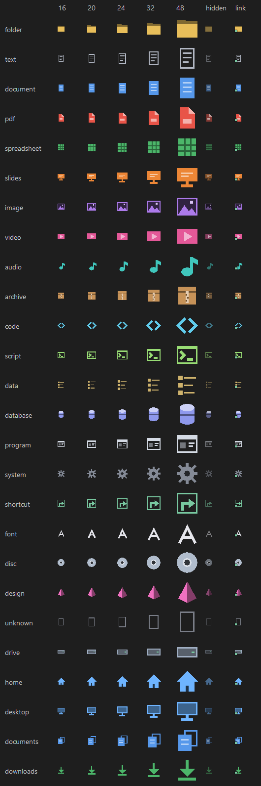
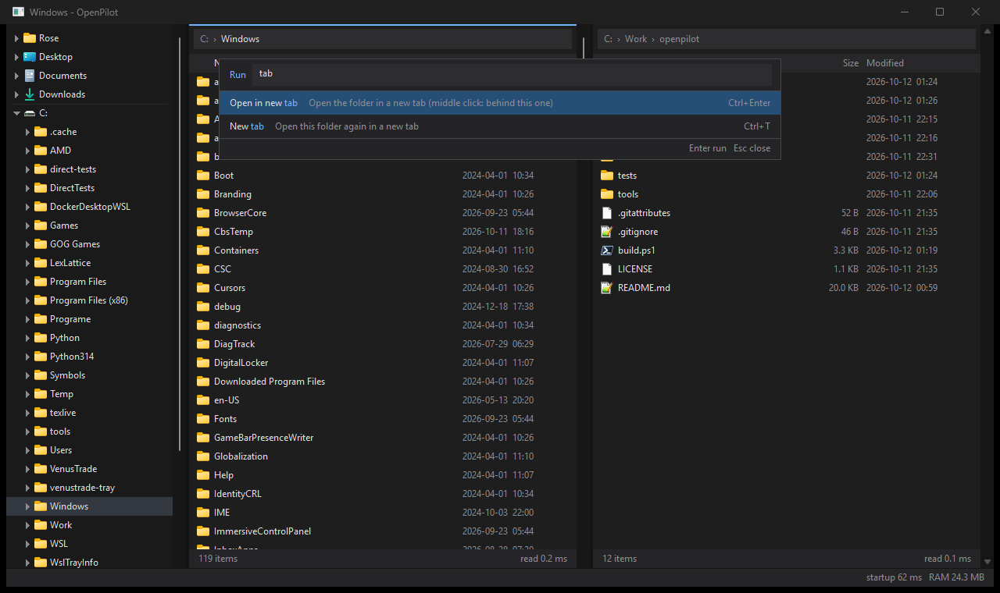
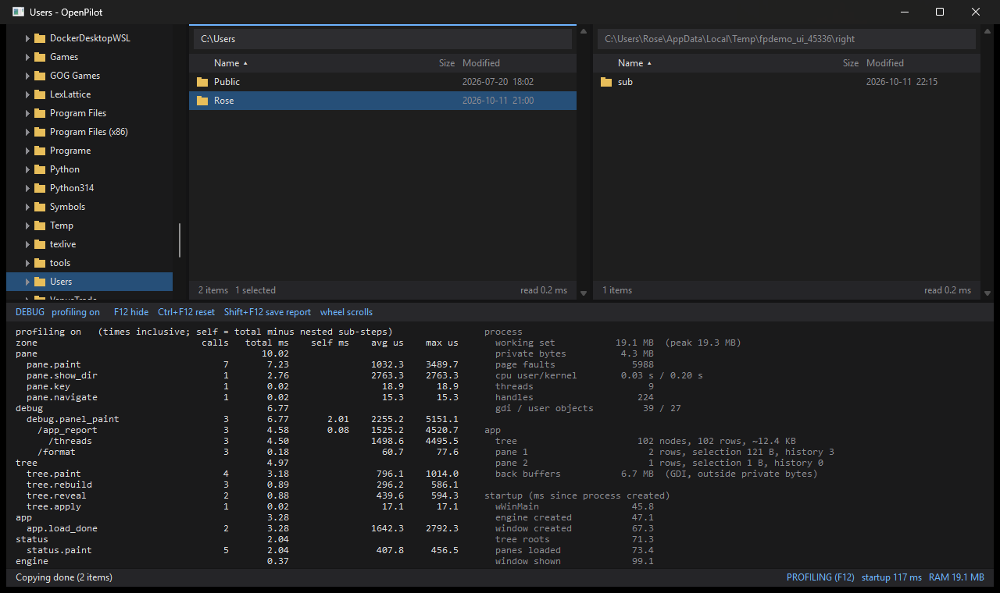

# Folderwing

[](https://github.com/L1nuxOne/folderwing/actions/workflows/build.yml)


**File manager for Windows and WSL.** Previously named OpenPilot.

[Visual identity](docs/BRANDING.md) · [Wordmark](docs/branding/folderwing-wordmark.png)

A native Windows and WSL file manager with an embeddable file engine. Preview and analysis tools run in separate helpers and load on demand.

[Build and portable releases](docs/RELEASING.md) · [Features](docs/FEATURE_ROADMAP.md) · [Third-party dependencies](docs/DEPENDENCIES.md)

Source and build workflows are published in [L1nuxOne/folderwing](https://github.com/L1nuxOne/folderwing). [Pinned build dependencies](https://github.com/L1nuxOne/folderwing/releases/tag/dependencies-20261025) are available now. Successful Windows CI runs produce portable build artifacts; version tags create draft application releases for review.

Inspired by how File Pilot feels to use. This is a clean-room project written against public Windows APIs. No code or data was taken from File Pilot, and nothing here was produced by disassembling it.


| Entry point | Purpose |
| --- | --- |
| `folderwing.exe` | Main file manager |
| `folderwing-cli.exe` | Command-line listing and file operations |
| `folderwing-engine.dll` | Embeddable C API |
| `folderwing-<role>.exe` / `folderwing-wsl` | On-demand Windows helpers and native Linux agent |

The portable package includes preview libraries and their notices; the core
executable's size does not represent the complete download. WSL, Everything,
Git and Direct are optional separately installed integrations. The standard
portable package excludes Direct.

## Why it feels instant

| Technique | What it buys |
|---|---|
| Bulk directory reads (`GetFileInformationByHandleEx` / `FileFullDirectoryInfo`, 256 KB buffer) | hundreds of entries per system call instead of one `FindNextFile` per entry |
| Flat snapshots: 48-byte records + one packed UTF-16 name pool, in reserved virtual memory | no per-file allocations, no COM objects, freed with a single call |
| Immutable, ref-counted snapshots | share between threads without locks; views never block loads |
| Index-based views (sort/filter move `uint32` indices, never entries) | re-sorting 5k entries in ~0.4 ms, filtering per keystroke in ~0.04 ms |
| Narrowing filters rescan only the visible rows | typing more characters gets cheaper, not more expensive |
| ASCII fast path for natural sort; NLS (`CompareStringEx` + `SORT_DIGITSASNUMBERS`) only for non-ASCII names | Explorer-like order without paying locale cost for every comparison |
| Stale-while-revalidate folder cache | Back/Up/revisits paint immediately from cache, then quietly refresh |
| Debounced `ReadDirectoryChangesW` watcher that triggers a reload | live folders without fragile incremental patching or overflow bugs |
| UI draws only visible rows into one back buffer (no list control, no per-row windows) | a 100k-entry folder paints as fast as a 10-entry one |
| Shell starts after the first frame; file icons are drawn by the app from the file type | painting never calls into the shell, startup never pays for COM, OLE or an icon cache, and the first frame already shows the final icons |

## Many features, little interface

Folderwing is not meant to be a minimal file manager. It is meant to be a very capable one whose interface only shows
what is relevant right now, and whose running cost only covers what is in use right now. Attention and computation
follow the same rule: a feature takes neither screen space nor resources unless it is relevant.

Every command in the demo is a **function** in one registry (`app/fn.h`). A function is a static table entry that
states its whole contract: what it does, what it applies to, its default keys, the menus it may appear in, the
Explorer verbs it takes over, what it needs, its options, and its **lifetime**. The core owns dispatch, key bindings,
menus, settings, timers and profiling. Functions never install hooks, timers or menu items of their own.

Three things are kept apart:

| | Meaning | Controlled by |
|---|---|---|
| **Capability** | the function is compiled in | the code; it costs disk space, and its code is only paged in when it runs |
| **Activation** | the function is switched on | `[functions] id = off`. Off means it never starts, never shows up, and its keys fall through. Functions that need it are off too. |
| **Exposure** | where an active function shows up | `[keys]`, `[menu]`, `[palette]`, and its conditions. A menu or the command palette only lists what applies to what you clicked or selected; a key only works where it applies. |

Lifetime is part of the contract, and the core enforces it:

| Lifetime | Rule | Examples |
|---|---|---|
| **hot** | needed all the time; starts at startup, or right after the first frame, unless the settings don't need it | `svc.shell` (OLE), `svc.drop`, `svc.icons` (only for Windows icons) |
| **warm** | starts on first use, may keep resources between uses, and stops after a set idle time or on request | `debug.panel` (profiling and a repaint timer, only while open) |
| **cold** | starts for one call; stops as soon as the call and its async work are done; may not own timers | almost everything: rename, copy path, sort, ... |

The registry has a single timer, armed only for the next thing that is due, so an idle window has no timer at all.
When a function stops, its timers end. If a cold function asks for a timer, or releases work it never held, the
debug panel reports a lifetime violation, and the UI smoke test fails.

Adding a function adds no startup cost and no permanent UI:

```c
{ .id = "file.copy_path", .title = L"Copy path", .about = "Copy full paths as text",
  .life = FN_COLD, .where = FN_ANYWHERE, .menus = FN_MENU_ITEMS | FN_MENU_FOLDER | FN_MENU_TREE,
  .keys = "Ctrl+Shift+C", .label = copy_path_label, .run = run_copy_path },
```

Functions call the app only through `app/app.h` and the context they are given, never through the window's internals.

**Settings** (`folderwing.ini` next to `folderwing.exe`, else `%APPDATA%\Folderwing\folderwing.ini`, or `--settings=FILE`; legacy OpenPilot settings and session data migrate by copying without overwriting):

```ini
; comments take a line of their own: after a value, a ; is part of the value
[functions]
; Go to lists only recent, open, pinned folders and drives
search.everything = off
; context menus without Explorer's items: no shell extensions ever loaded
menu.explorer = off
[menu.context]
; Windows draws context menus, Explorer's items included (slower: see Numbers)
style = native
[keys]
file.new_folder = F8, Ctrl+Shift+N
; free Backspace
nav.up = Alt+Up
[menu]
; keep the key (if any), drop it from menus
shell.terminal = off
[palette]
; not offered in the command palette
debug.reset = off
[shell.terminal]
; terminals run cmd (auto: pwsh, else powershell, else cmd; profile: Windows Terminal's default profile, e.g. WSL)
shell = cmd
[view.icons]
; programs and shortcuts keep their makers' icons (starts svc.icons: +2 MB, +1 thread)
style = mixed
; extra extensions for a category
code = nix
```

Some switches trade a feature for cost. Measured idle private memory: **3.6 MB** with type icons (the default),
**5.6 MB** with `view.icons` `style = mixed` and **5.8 MB** with `style = windows`, which need Windows' icon service. `fpdemo --functions` lists every function with its lifetime, current keys, what it needs, its
options and any problems in the settings file. A key can be bound to several functions; the first one that applies
runs. That is how F5 copies to the other pane when two are shown and refreshes otherwise.

**Settings apply while you work.** Saving the file is enough: the window's message loop waits on the file's folder
(no thread), and 300 ms after the last write it reads the file once, compares it with what it applied, and
reconfigures only the functions whose section changed. Services start or stop as the new settings need them; a
few things that only make sense at startup (`session.restore`) wait for the next start, and their card in the
settings panel says so. The status bar
reports how many functions changed or the first problem. An option with a fixed set of values (`style = ours mixed
windows`) or a range rejects anything else and keeps its default, so a typo never leaves a half-applied state.
`settings.edit` opens the file in your editor, and writes a template listing every option, commented out, when
there is none yet.

## Icons that say what a file is

On Windows a file's icon mostly says which app claimed its extension last: the same `.txt` shows a Notepad++ logo on
one machine and a Notepad page on another, and installing an app can quietly restyle your folders. Folderwing draws
its own icons from the file type instead. They show what a file is, look the same on every machine, and no installer
can change them.



- **19 categories, by shape first**: text, document, PDF, spreadsheet, slides, image, video, audio, archive, code,
  script, data, database, program, system, shortcut, font, disc image, design, plus unknown. Each has its own shape,
  and color only helps scanning, so they still work for color-blind users. Places (home, Desktop, Documents,
  Downloads, drives) get their own icons in the tree; pinned folders are drawn in the accent color.
  An expanded **Linux** root beside the drives lists installed WSL distributions;
  their folders load on demand. Discovery does not start Linux. See [Linux tree](docs/WSL_TREE.md).
- **About 500 extensions** and well-known names without one (`Makefile`, `Dockerfile`, `LICENSE`, dotfiles such as
  `.gitignore`). A lookup is a binary search on the extension; the file itself is never touched.
- **Drawn, not loaded**: plain GDI shapes on a 16-unit grid, crisp at 100% and scaled at any DPI. No shell, no icon
  cache, no worker thread, so the first frame shows the final icons and nothing pops in later.
- **Cheaper**: idle private memory drops from 5.8 to 3.6 MB, because the Windows icon
  service (`svc.icons`) no longer starts and one fewer thread runs.

`[view.icons]` in the settings chooses the tradeoff:

| `style =` | What you see | Cost |
|---|---|---|
| `ours` (default) | type icons everywhere | none: `svc.icons` never starts |
| `mixed` | type icons, except programs and shortcuts, which keep their makers' icons (for those, the icon is the identity) | +2 MB, +1 thread |
| `windows` | the icons Windows shows | +2.3 MB, +1 thread |

Each category also takes extra extensions (`code = nix`, `data = bak`); those win over the built-in table.
## Numbers

Measured on the dev machine (warm cache, medians; `fpe bench <path>`):

| | `C:\Windows\System32` (5,032) | `C:\Windows\WinSxS` (27,181) |
|---|---|---|
| `fpe_dir_read` | **1.96 ms** | **32.5 ms** |
| `FindFirstFileEx` loop, storing nothing | 1.89 ms | 29.8 ms |
| `FindFirstFileEx` + malloc per entry (typical app) | 2.38 ms | 38.1 ms |
| sort by name (natural) | 0.39 ms | 5.6 ms |
| filter per keystroke | 0.04 ms | 0.53 ms |
| snapshot memory | 82 bytes/entry | 238 bytes/entry (long names) |

Reading a folder costs about the same as just enumerating it, because the filesystem is the floor.

Demo window (`folderwing.exe`, tree + two panes): **~90–110 ms median from process creation to first frame**
(`tests/startup_bench.ps1`), **~3.6 MB private memory**, 9 threads. Windows' own icons (`view.icons` `style = windows`)
add ~2.3 MB (mostly the shell's system image list) and a thread.

The shell's own context menu is the expensive exception, as in Explorer: the first one loads every installed shell
extension into the process (here: 89 DLLs, 10 threads, **+13 MB**, **1.6 s**); later ones take ~100–270 ms. That is
why Folderwing's context menu doesn't build it until **More from Windows…** is picked; the menu itself opens in ~5 ms.

## Build

Requires [Zig](https://ziglang.org/download/) (used as a C compiler; no Visual Studio needed).

```powershell
# Supply the pinned GNU archive locally or set FOLDERWING_PDFIUM_BASE_URL.
./tools/get-pdfium.ps1 # optional: PDFium preview (8.96 MB DLL); see docs/PDFIUM_GNU_ADOPTION.md
./tools/get-libvterm.ps1 # optional, once: libvterm for the panel terminal (pinned source, built in)
./build.ps1            # release build -> build/release (also the WSL helper, a static Linux binary)
./build.ps1 -Test      # build + engine and app tests (WSL tests use the default distro, skipped without one)
./tests/ui_smoke.ps1   # drives the demo: copy, filter, history, tree, split, debug mode, rename, menus, properties,
                       # tabs, session, settings, palette, Everything search, PDF preview, WSL folders, relays, terminal
./tests/dragging.ps1         # real tab gestures, OLE release choices, shortcuts and native WSL drops
./build/release/dropwarm_tests.exe # OLE worker failure, cancellation and cleanup contracts
./build/release/panel_paint_tests.exe # dirty-region pixels, scaled hit geometry, frame ACKs and GDI cleanup
./tests/folder_views.ps1     # per-folder layout/sort, defaults/reset, restarts and WSL identities
./tests/relay_setup.ps1     # Settings command creation, preview, atomic saves, imports and invocation
./tests/thumbnails.ps1      # thumbnail pixels, grid actions, lazy/cache bounds, helper recovery and WSL
./tests/operations.ps1      # Operations: conflicts, cancellation, errors, retained results and crash recovery
./tests/startup_bench.ps1   # process start -> first frame, over several launches
./tests/budget.ps1     # speed + memory guardrails (see below)
```

### Budgets

`tests/budget.ps1` runs after every feature pack. It measures startup, idle memory, the slowest UI-thread message
during a scripted workload (sorting, filtering, scrolling and navigating the 27k-entry `C:\Windows\WinSxS`), engine
read/sort times and binary sizes. It prints each number next to the previous run, appends the run to
`build/budget/history.csv`, and exits non-zero when a budget is exceeded:

| Budget | Limit |
|---|---|
| startup, median of 10 launches | 150 ms |
| private memory, idle with two folders open, default settings | 5 MB (was 7 MB while Windows icons were the default) |
| slowest UI message, best of 2 workload runs (dialogs, menus and window drags excluded) | 16 ms (one frame at 60 Hz) |

What it caught so far:

- Sorting a name-ordered listing descending hit the merge sort's worst case: 46 ms for WinSxS, now ~10 ms like the
  other keys.
- Shell icons first cost a 24 ms stall after the first frame (building the system image list) and a 20 ms first paint
  (type icon lookups). Both moved to the icon worker; the UI thread now spends ~7 ms on OLE setup.

`build.ps1` uses `zig` from `PATH`, `$env:ZIG`, or `%USERPROFILE%\tools\zig-x86_64-windows-0.17.0\zig.exe`.
Compilation writes to `build/<config>/.link` first. Byte-identical outputs retain their published file identity
and modification time; failed compilations retain the working image. A changed image that is running is renamed
to an `.old` sibling before publishing the completed replacement. `-Test` checks these cases with actual compiler
outputs and a loaded DLL, through `tests/build_output.ps1`. Optional PDF and terminal outputs are retired when
their dependencies are absent; copied PDFium and WebP assets are verified against their inputs by SHA-256. On a
machine with WSL, the Linux helper is published by a native rename from the staged build. An interrupted native
publication remains marked pending and an identical rebuild finishes that step.

For panel startup diagnosis, set `OPENPILOT_PANEL_STARTUP_LOG` to a local CSV file before launching the app.
Host and Settings append PID, thread ID, performance-counter ticks/frequency and stage names for process
creation, HELLO, fonts, the first frame and the applied settings snapshot. The profiler also records
`panel.launch.create_process` on the launcher thread. Settings command setup waits for its first applied snapshot;
process/window creation alone does not indicate that it can accept setup input.

## Engine API (`include/fpe.h`)

```c
/* Snapshots: immutable, ref-counted */
fpe_dir *d;
fpe_dir_read(L"C:\\Users", &d);
fpe_dir_count(d); fpe_dir_entries(d); fpe_dir_name(d, entry);

/* Views: sorted + filtered rows over a snapshot (single-threaded) */
fpe_view *v = fpe_view_create(d, NULL);          /* name, dirs first */
fpe_view_set_filter(v, L"rep");                  /* case-insensitive substring */
fpe_view_set_opts(v, &(fpe_view_opts){ FPE_SORT_SIZE, 1, 1, 0, 0 });
fpe_view_at(v, row); fpe_view_name(v, row); fpe_view_find(v, L"report.pdf");
fpe_view_set_dir(v, newer_snapshot);             /* keeps sort + filter */

/* Engine: async loads + folder cache */
fpe_engine *e = fpe_engine_create(NULL);
fpe_dir *cached = fpe_engine_cached(e, path);    /* paint this now (may be NULL) */
fpe_engine_load(e, path, on_loaded, ctx);        /* fresh snapshot on a worker */

/* Watching */
fpe_watch_start(path, 80 /* ms debounce */, on_changed, ctx, &w);

/* WSL: \\wsl.localhost\<distro>\... is listed and watched by the distro's helper */
fpe_wsl_configure(&(fpe_wsl_config){ 1 /* on */, 0 /* not root */, 60000 /* idle ms */ });
fpe_unix u;
if (fpe_dir_unix(d, entry, &u)) { u.mode; u.owner; u.group; u.link; }

/* Jobs: queued copy / move / delete / recycle with progress */
fpe_job_submit(e, FPE_OP_COPY, srcs, n, dest_dir, FPE_CONFLICT_RENAME, on_progress, ctx);
fpe_job_cancel(e, job_id);
```

Rules: strings are UTF-16, errors are Win32 codes (0 = success), callbacks run on worker threads (post to your UI thread), views belong to one thread.

### File operation safety

- Copying or moving a folder into itself is refused.
- Windows permanent delete records each scanned object's full file identity and creation time. It pins
  canonical ancestors, verifies identities before descent, enumerates held directories and removes through
  the verified handles. Changed or newly added entries are preserved with an explicit error; a failed scan
  leaves that selected tree intact. Explicit parent aliases resolve once. Unsupported identity queries fail
  explicitly. This does not provide crash durability or an atomic all-or-nothing tree deletion.
- Junctions, directory symlinks and mount points are **never traversed** by delete or copy. Deleting a folder that contains a junction removes the link, not its target. This is covered by a test.
- Linux recursive jobs and cross-distro transfers report an error at mounted source children or mounted
  destination merge folders, including same-device bind mounts and mounted files. Ordinary siblings can finish;
  a move retains each blocked source subtree. Selecting a source mountpoint itself is refused. Browsing inside a mounted
  volume and selecting its children, or explicitly choosing a destination inside that volume, remains supported.
  Same-volume renames do not descend the tree. Mount checks use `openat2` where available and descriptor mount
  IDs on older kernels; unavailable mount identity fails explicitly. `tests/test_mount_jobs.py` exercises real
  tmpfs and bind mounts in a private user/mount namespace, including the older-kernel fallback.
- Cross-volume moves copy then delete per file; a source folder is only removed once it is empty, so anything skipped or failed stays where it was.
- Same-volume moves are renames (instant, no tree walk).
- Native Windows file copies and copy-based moves check a full persistence barrier for every copied
  data stream, including empty named streams, before publication. A failed stream barrier preserves the
  source and any previous destination and stops later selections. Named streams use the ordinary writer;
  single-stream NTFS folder batches retain their existing barriers.
- Conflicts: keep both (`name (2).ext`), skip, overwrite (folders merge), or fail.
- Windows copies stage a unique `.openpilot-copy-*.tmp` sibling and retain the actual `CopyFileExW` destination
  handle through publication. Cancellation discards that held object; an existing overwrite target keeps its
  bytes, attributes, DACL and streams until a completed replacement commits. Successful copies preserve source
  metadata and alternate streams, and overwrites retain the destination DACL. The committed replacement contains
  the copied file's streams; destination-only streams remain intact on cancellation or failure.
- Windows copy/move merges refuse source or destination junctions before enumerating their children. Ordinary
  merges still work, and same-volume moves may relocate a junction itself when no merge is required. Explicit
  root aliases resolve once to captured physical paths; rebinding an alias does not redirect an accepted job.
  Directory names stay pinned during the walk. A handle-relative rename briefly relaxes only its destination's
  write barrier, then validates and restores it before any further path operation. An in-place reparse change
  stops remaining work and retains an error; it never triggers a retry through the new target.
- Copy-based Windows moves anchor the read source, acquire and verify a removal handle before publication, and
  check the source version again before deletion. Detected post-commit changes retain both the completed target
  and source with an error. Version checks and the final mutation are separate operations, not atomic conditional
  replacement/deletion against uncooperative writers. Unsupported filesystem or access checks fail explicitly.
  If a provider supplies no destination callback handle, no unanchored file is published or removed by name;
  an uncertain staging sibling can remain for inspection.
- Recycle uses the shell with `FOF_WANTNUKEWARNING`, so items that can't go to the bin are never silently deleted.

## Two-pane folder comparison

With both panes visible, choose **Compare folders...** from a pane context menu
or press **Ctrl+Shift+F7**. It captures the physical left and right pane folders
and compares their **current level**, including hidden items. Check **Include
subfolders** and choose **Compare again** to compare the complete folder trees. Navigation in the
panes remains available while the review window is open.

Rows distinguish left-only/right-only regular files, size and exact modification
date differences, matching metadata, file/folder conflicts, and excluded links or
special items. In recursive mode, folder rows group their descendants and both
name columns show relative paths. Current-level folder rows remain explicitly
unexamined. Links, reparse points and mount boundaries are excluded. An unreadable
subtree or a limit reached makes the scan incomplete and disables copies. Windows-only pairs ignore name case;
if either side is native WSL, names match exactly. Ambiguous Windows case matches
are excluded instead of choosing an arbitrary file. Selected results show logical
byte counts and modification times in UTC.

Enable **Verify file contents with SHA-256** and choose **Compare again** to read
matching-size regular files. Only successful hashes say **Contents match**;
matching metadata always says contents are unchecked. Hashes reject leaf links,
reparse points, devices and FIFOs, and check for source changes during each read.
A changed/inaccessible file is unverified, with its Windows error in the details.
Windows reads deny concurrent write/delete opens while hashing; Linux checks are
best effort against concurrent changes. A scan is a live snapshot, not a locked
backup or a promise that files will remain unchanged afterward.

Use Ctrl/Shift to select **1–256 differing regular files** present on the source
side, then **Copy selected → right** or **Copy selected ← left**. Copies enter
**Operations** as Ready to start: review its conflict policy and choose Start.
Recursive copies form one job, preserve the selected relative paths, and create
missing destination parent folders only after Start. They copy selected regular
files, including Windows/WSL and cross-distro transfers; folder rows and empty
folders are not copied. Selections are bounded to 60,000 path characters.
Both modes recheck selected sources when the job starts: a file replaced by a
folder reports an error without copying its children.
Enabling Operations is required; there is no immediate-copy fallback. Matching,
unverified, ambiguous, conflict, and folder rows cannot be copied here. Run
Compare again after changes or transfers. This view does not delete or sync files.

Recursive scans stop at 128 directory levels, 100,000 combined entries or 64 MiB
of relative-path text. Directory handles guard traversal; WSL uses native
descriptor anchors and refuses missing helpers without a 9P fallback. Cancellation
retains incomplete results and waits for the current filesystem call.

Operations opening also defers each pane's address/scrollbar update into one
counted UI dispatch; live resizing flushes those updates before painting.

The cold window owns one background worker and a virtual result list, with at most
one queued progress notification. Returned rows are limited to 100,000 combined
folder entries; larger comparisons fail explicitly. **Cancel scan** retains
incomplete results and disables copying; closing a busy window requests a stop.
Cancellation is cooperative around current filesystem calls. Native WSL hashing
uses a separate read-only helper, literal byte paths, the captured configured
user, a 30-second helper inactivity limit, and no 9P fallback or automatic
elevation. WSL directory snapshots use the configured browsing helper user.

`tests/folder_compare.ps1` covers the real Windows/WSL review and staged copies;
`tests/test_file_hash.py` covers native hash framing, literal names, source
changes, denied access and cancellation. Engine cases live in `tests/tests.c`.

## Bulk rename

Select up to 256 files/folders and choose **Bulk rename...**, press **Ctrl+Shift+F2**,
or press **F2** with multiple items selected. Single-item F2 keeps inline rename.
The cold `file.bulk_rename` function can be disabled or rebound in Settings.

Use literal, case-sensitive find/replace, prefixes, suffixes and optional `_number`
suffixes (start 0–999999999, padding 1–9 digits). Extensions are preserved by default:
only the last extension is protected; dotfiles such as `.env` have no extension,
and folders use their full names. Numbering follows the captured visible pane order.
Names are validated against Windows or native Linux rules, including Linux's 255-byte
limit. Full before/after names and per-item results are available in the list/details.

**Preview** reads current metadata and checks names without renaming anything.
Editing a rule invalidates that review. **Apply** rechecks source identities and every
target before starting. Occupied targets, duplicate outputs and swaps are conflicts;
existing files are never replaced. A target appearing after preflight fails that row,
while already completed renames remain applied. Folder contents keep their names.
**Cancel remaining** stops between requests/items; completed renames are retained.
The editor keeps its source folder while the panes navigate independently.

Windows uses metadata handles and [non-replacing file rename handles](https://learn.microsoft.com/en-us/windows/win32/api/winbase/ns-winbase-file_rename_info). WSL uses one isolated native helper per
batch with the user captured when the editor opens, without automatic elevation or
9P mutation fallback. Linux identity checks are best effort against concurrent
changes, with kernel no-replace protecting existing targets. A missing mutation reply
is labelled **Outcome unknown**; Apply/Preview are disabled until the selection is
reopened, so an uncertain rename is never automatically retried.

`tests/bulk_rename.ps1` covers real Windows/WSL workflows and a private reply-loss
fixture. `tests/test_bulk_rename.py` covers the native Linux protocol as the default
unprivileged user; Windows engine and pure rule contracts run with `build.ps1 -Test`.

## Saved workspaces

Press **Ctrl+Alt+W** for **Saved workspaces**. Save a named set of both panes'
folder tabs, active tabs, sorting and pane/tree layout, then switch between setups.
Save as and Update selected are explicit: temporary navigation never overwrites
a named workspace. Rename and confirmed deletion manage the saved list.

Restored folders load asynchronously; inaccessible tabs retain their address and
show an error, with Refresh available to retry. Catalog I/O runs on a worker,
uses exact session path encoding and rejects concurrent stale updates. The
catalog is separate from the automatic exit session, at `<session-file>.workspaces`.

[Usage, storage and limits](docs/SAVED_WORKSPACES.md).
Focused acceptance: `./tests/workspaces.ps1`.

## Action dock

A compact action dock provides icons for file/content search, comparisons, size
analysis, duplicates, Git, workspaces, terminal and Operations. Right-click it or
use **More** to try **Left edge**, **Tree bottom**, **Top** or **Hidden**, toggle
labels and choose visible buttons. Tree bottom is the default, with at most two
rows. **Action dock options** in the command palette restores it when hidden.

Buttons reuse the registered commands and preserve file-pane selection. Hover
for tooltips/shortcuts; use Tab, arrows and Enter/Space for keyboard access.
[Usage and settings](docs/ACTION_DOCK.md). Focused acceptance:
`./tests/action_dock.ps1`.

## Git integration

Press **Ctrl+Alt+G** or choose **Git status** for a read-only repository snapshot.
The separate helper lists staged, unstaged, untracked and conflicted paths, shows
branch/tracking information, and supplies optional cached file badges. Diff a
staged or working change with the existing viewer, preview/reveal files, or open
a repository terminal. Refresh is explicit; Windows and native WSL Git are used
for their respective repositories.

See [usage and limits](docs/GIT_INTEGRATION.md).
Focused acceptance: `./tests/git_integration.ps1`.

## Duplicate finder

Choose **Find duplicates** for the current folder or selected folders, or **Find
duplicates in both panes** for both displayed roots. A separate read-only helper
checks size, SHA-256 and complete bytes, then groups verified copies. Review full
paths, preview files, reveal in either pane or copy a path. Progress, Stop and
Refresh are available; hiding retains results. Windows and native WSL roots can
be scanned together. There is no deletion command.

See [usage, guarantees and limits](docs/DUPLICATE_FINDER.md).
Focused acceptance: `./tests/duplicates.ps1`.

## Audio and video previews

Select a media file for a paused preview beside the source pane. Play/pause,
seeking, volume/mute, duration and video dimensions are available; video posters
also work in thumbnail view, and archive entries can preview in the third pane.
Decoding stays in an on-demand restricted helper: Media Foundation first, with
libmpv loaded only for unsupported formats. Leaving a file pauses playback.

See [controls, settings and current acceptance status](docs/MEDIA_PREVIEWS.md).

## File differences

Select one file in each pane and press **Ctrl+Alt+D** or choose **Compare files**.
The separate **File differences** helper shows aligned text columns, line
numbers, added/removed/changed lines, linked scrolling and next/previous change
navigation. Binary and oversized files get a full-byte equality-and-size summary.

The comparison is read-only, cancellable and retained when hidden. Windows and
accessible WSL UNC files can be compared, including mixed pairs. Text view is
bounded to complete files of 2 MiB / 100,000 lines per side; large rewrites use
clearly labelled coarse alignment. Byte equality is separate from decoded-text
equality. Drag the panel's left edge for more comparison width.

[Usage, semantics and limits](docs/FILE_DIFFERENCES.md).
Focused acceptance: `./tests/file_diff.ps1`.

## Search inside files

Use **Ctrl+Alt+F** or **Search inside files** on a folder to open the on-demand
**Find in files** panel. Enter text, optional filename patterns (`*.py;*.md`),
choose case/whole-word/subfolder options and press Start. Results show paths,
line/column numbers and highlighted matching-line excerpts. Open a result to
select its exact match in the existing text preview, or reveal it in either pane.

Windows searches in the separate helper; WSL executes natively through its Linux
helper. Stop retains partial results; edits invalidate old query actions; hiding
and reopening retain the search. This first version uses literal matching and
bounded scans, with explicit binary/large-file/error counts.

[Usage, encoding semantics and limits](docs/CONTENT_SEARCH.md).
Focused acceptance: `./tests/content_search.ps1`.

## Disk-space analyzer

Right-click a folder or drive, a tree folder, or pane background → **Analyze space**.
The separate **Space** panel provides an expandable size tree, largest files and
file-type breakdowns from one metadata traversal. Breadcrumbs, filters and sorting
operate on the captured results. Switch between logical size and reported file
allocation; hard-linked allocation is counted once and unknown values are labelled.

Reveal results in either pane or open the existing preview handler. Stop retains
partial results; Rescan starts fresh. Hiding the panel preserves its scan/results;
**Space analyzer** in the command palette reopens it. Ordinary browsing starts no
scanner. Windows runs in the panel worker; WSL uses the native Linux helper only
for a requested WSL root, without stopping the running subsystem.

Whole fixed NTFS volumes use an on-demand elevated metadata worker, a checked
per-user disk cache, USN catch-up and activity-based refresh. Cached/live/paused
and incomplete states are explicit; hiding pauses polling and showing catches up.
Ordinary folders and WSL keep their existing scanner; unavailable NTFS capability
falls back to standard traversal. No browsing-time service is installed.

[Usage, allocation semantics and bounds](docs/DISK_SPACE_ANALYZER.md).
Focused acceptance: `./tests/space_analyzer.ps1` and `./tests/ntfs_analyzer.ps1`.

## On-demand folder sizes

Right-click one folder, a tree folder, or empty space and choose **Calculate folder size**
(`file.folder_size`, also available in the command palette). A separate background window
shows logical bytes, file/folder counts, excluded items and errors. Folder counts include
the selected root. Cancel retains clearly incomplete totals; Recalculate reads fresh metadata.
The main panes remain usable while it runs. Ordinary browsing does not calculate sizes.

Windows uses metadata handles; WSL uses an isolated native helper with the configured
WSL user, without automatic elevation. Disabled/unavailable native WSL integration reports
a partial result. No file contents are read. Hard links count once per name; symlinks,
Windows reparse points, special files and Linux mount boundaries are excluded. Unreadable,
changed or over-depth (128 levels) subtrees produce partial totals. This measures a live
filesystem, not an atomic snapshot or space allocated on disk. One folder is measured at a
time, and results are not cached in the file-list size column.

`tests/folder_sizes.ps1` exercises Windows and WSL through the real app;
`tests/test_folder_sizes.py` exercises the native Linux protocol as the default unprivileged
user. Native Windows sizing contracts run with `build.ps1 -Test`.

## Demo

Folder tree on the left, two file panes, and a shared status bar for jobs. Drag the dividers to resize. The tree
lists your pinned folders, home, Desktop, Documents, Downloads and every drive. It expands lazily, follows the active
pane, and updates live whenever a pane reloads the same folder. `folderwing.exe [left-folder] [right-folder]` picks the
start folders.

Workspace:

- **Tabs** in each pane. The strip only appears once a pane has two tabs. A tab that isn't shown keeps only its
  folder, history and sort order: no snapshot, no view, no watcher. Twenty extra tabs measured no change in private
  memory. Showing a tab again goes through the folder cache and restores its folder's view choices. Middle-click a folder, a crumb or a
  tree folder to open it in a tab behind the current one; middle-click a tab to close it; double-click the empty strip
  for a new tab. Drag a visible tab to reorder it, or into the other visible pane to move it. The insertion
  marker shows where it will land; dropping in the other pane's content appends it. A moved tab keeps its path,
  cursor, sort and back/forward history; the destination shows it and the source keeps a usable tab. Escape,
  lost capture or a drop outside the panes cancels. A full pane (32 tabs), hidden pane or still-loading shown tab
  refuses the drop. A click selects its tab on release. Narrow tabs hide their close button so their label remains
  draggable; middle-click or Ctrl+W still closes them. `tab.drag = off` keeps ordinary tab selection. Floating
  tabs and canvas layouts remain future work.
- **Breadcrumbs**: the address bar shows the path as clickable folders (leading ones fold into `...` when they don't
  fit). Clicking a crumb goes there and selects the folder you came from. Click the empty space after the crumbs, or
  press Ctrl+L, to type a path. `view.breadcrumbs = off` keeps a plain text box.
- **Pins**: Ctrl+D or "Pin to tree" keeps a folder at the top of the tree. Pins aren't checked on disk at startup,
  so a pinned network folder never delays the window.
- **Session**: on exit the window saves its size and position, layout, each pane's tabs, the pins and the recent folders to
  `session.ini`, next to the settings file (or in `%APPDATA%\Folderwing`). The next start reads one small file and only
  the shown tab of each pane; restoring 10 tabs per pane added ~2 ms to startup (61 vs 59 ms median). Folders on the
  command line replace the restored tabs. `session.restore = off` starts fresh every time but keeps the pins;
  `--session=FILE` picks another file, and `--session=` alone neither reads nor writes one.


**Folder views** (`view.folder_memory`) remember each folder's explicit sort order, list/thumbnail layout and
thumbnail size. Changing these choices automatically records an override; going back, switching tabs or returning
in another pane restores it. A new folder starts with ascending name order and the current `[view.thumbnails]`
mode/size defaults. Fields you have not changed keep following those defaults. Two panes showing the same folder
update together, while different folders keep independent choices.

- **Reset this folder's view** is in the context menu and command palette. It removes that folder's overrides
  and applies the current defaults, leaving every other folder alone.
- Up to 256 recently changed folders are kept in `folder-views.txt` beside the session file. It is read once at
  startup, cached for navigation, and written on clean exit/logoff using a temporary file and atomic replacement.
  Writes merge only this window's changed fields and resets with the latest file, under a per-file lock, so windows
  changing different folders or different fields keep both. Unchanged stale entries cannot resurrect a reset.
- Windows paths ignore case. Jobs refuse Windows operands with literal dot/space suffixes before normalization,
  rather than operating on a normalized sibling; typed `.`/`..` navigation is still accepted. The CLI refuses
  more than 256 non-option operands (including the destination) before submitting any operation.
  The Linux part of WSL paths preserves case, Unicode and significant spaces;
  `\\wsl$` and `\\wsl.localhost` spellings share a preference. Symlink targets and alternate drive mappings are
  not resolved. No folder or file metadata is read to find a preference.
- `view.folder_memory = off` retains the previous pane behavior and stops recording new choices; the saved file
  is kept. `session.restore = off` disables tab restoration while folder views still work. `--session=` disables
  folder memory along with session storage. Disabling thumbnails temporarily shows lists without deleting a
  remembered thumbnail choice. Abrupt termination before exit can lose this run's unsaved changes.
- Paths are limited to 4095 UTF-16 units; malformed rows are ignored, files over 4 MB are refused, and unknown
  file versions are preserved rather than overwritten. Native tests cover identity, parsing, bounded eviction,
  merge/reset transactions and failed writes. `tests/folder_views.ps1` checks the actual desktop behavior.

**Operations** (`operations.show`, Ctrl+Shift+O) opens in the side panel. A button in the status bar also
opens it once there are jobs or results. Copy/move from F5/F6, paste, and drops all use the same workflow:

- **Choose before starting.** The source, selected item count and destination show first. Choose **Keep both**
  (numbered copies), **Skip existing** (existing files stay; folders merge), or **Replace files** (files are
  overwritten; folders merge), then **Start**. Replace is explicit and is never the default. Cancelling here
  touches no files and preserves a cut clipboard. `[operations.show] conflicts = keep | skip | replace` sets
  the initial choice, still confirmed with Start.
- **Cancel work.** Cancel applies to a queued or active job. Copy cancellation removes the partial file; files
  already copied or moved stay where they are. Windows overwrite targets remain intact until replacement commit.
  Recycle can stop between selected items, after the current
  Windows shell call returns. Delete and recycle enter the same results view after their usual confirmation.
- **Keep results.** Up to 64 jobs/results remain for this app session, even after closing or restarting the
  panel app. Active and pending jobs are never evicted. At the limit, the oldest finished result gives way;
  **Clear completed** removes only finished results. The explorer owns this state and the job queue, so the
  panel can close, hang or crash while operations continue. Closing Folderwing ends the session history.
  Whole-app/host interruption does not restore this history or automatically resume transfers. Staging
  leftovers are kept for review; see [interrupted transfers and staging review](docs/TRANSFER_CRASH_RECOVERY.md)
  for the read-only command and the publication/source-removal boundaries.
- **Understand failures.** Each result shows items processed, bytes processed, skipped/error counts and elapsed
  time. Failed and skipped paths have their Windows error or skip reason. Processing totals include unsuccessful
  attempts; **Finished with errors** and **Finished with skips** remain distinct from **Completed**. A result
  retains up to 64 diagnostics / 65,536 characters and explicitly counts any additional diagnostics omitted.
  **Copy result** (Ctrl+C in Operations) copies the summary and retained diagnostics.
- **Use the keyboard.** Start has focus on a new transfer; Left/Right changes the conflict choice. Tab/Shift+Tab
  reaches controls, Enter/Space uses one, Up/Down selects jobs, PgUp/PgDn scrolls details, Esc hides the panel.
  The Operations process starts only on demand and ends when hidden; reopening replays the retained results.

`folderwing-operations.exe` is a separate, small native program using the same shared-pixel panel protocol as settings
and the terminal. Switching `operations.show` off restores direct transfers with Keep both and status-bar
progress. The engine's original `fpe_job_submit` ABI is unchanged; `fpe_job_submit_ex` adds an optional per-item
error/skip callback for clients that need diagnostic history.

Palette (`app/palette.c`), one overlay with three modes. It exists only while open: the window, its lists and any
search results are created when it opens and freed when it closes, so a closed palette costs nothing.

- **Go to** (Ctrl+P, Ctrl+G): the last 50 folders shown, open tabs, pins, home, known folders and drives, ranked by
  a fuzzy match as you type (`dl` finds Downloads, `work ope` finds `C:\Work\openpilot`). From two letters on it also
  asks [Everything](https://www.voidtools.com/) for matches on every disk. Enter goes there, Ctrl+Enter opens a new
  tab, Shift+Enter uses the other pane. For a file, Enter shows it selected in its folder and Shift+Enter opens it.
- **Commands** (Ctrl+Shift+P, F1, or `>` in Go to): every function the registry offers that applies right now, with
  its key. It is the same check menus use, so with one tab open "Close tab" isn't offered.
  `[palette] id = off` hides a function here without touching its key; `FN_HIDDEN` keeps mouse-only functions out.
- **Search this folder** (Ctrl+F, Ctrl+E): Everything for indexed Windows folders, with an automatic live
  recursive scan when Everything is unavailable, the folder is absent from its index, or IPC fails. Native WSL
  paths use an explicitly selected, current native index or scan inside their distro. The footer identifies
  the backend and reports incomplete scans.
- **Search this folder live** (Ctrl+Shift+F): bypass the index, including its exclusions, and read current names.
  While the search overlay is open, the same key switches the current query to live search.
  Enter reveals a file or navigates to a folder; Ctrl+Enter opens a tab; Shift+Enter opens a file.
  Revealed files use the existing copy/move and Operations workflow.

Folder-search syntax is shared across backends: words are ANDed, quotes preserve spaces, `*` and `?` match a
whole filename, `ext:txt;pdf`, `file:` and `folder:` filter types. Matching ignores case and preserves accents.
Quote literal colons, for example `"a:b"`. `size:>=10mb` (binary units) and `dm:>=2024-01-01` (UTC midnight)
use live metadata; a bare `dm:2024-01-01` matches that UTC day. Unsupported syntax reports a query error.
Go to retains Everything's full search syntax for its disk-wide results.

For WSL folders, **Index...** in the search header enables indexing for that folder and its subfolders.
The same surface is available as **Manage WSL search index** in Commands. The menu pauses/resumes,
rescans/rebuilds, or removes the selected folder's index; when searching a covered subfolder, the footer
and menu show the actual selected ancestor. Selection is off by default and stored per Linux UID inside
that distro's private `${XDG_CACHE_HOME:-$HOME/.cache}/openpilot-search-v1` directory. No Windows SQLite
DLL is loaded. The existing registered-distro and deployed-helper checks gate the feature.

The footer reports **Off**, **Scanning**, **Current**, **Updating**, **Paused**, or **Unavailable / incomplete**.
One native watched root is kept active per app process, on demand, until another root is needed or the app
exits. Saved indexes reconcile on every helper restart before becoming current. Native inotify events
debounce a full reconciliation; while rebuilding, paused, unavailable, or incomplete, queries use live
search. A busy tree may remain Updating until it settles. Root changes, overflow, inaccessible folders,
watch exhaustion and scan limits never produce a successful empty indexed answer. Pause closes watches
and the retained index session;
remove deletes only the derived cache and selection. Windows-only browsing starts no index process.

The Linux-only static SQLite 3.54.0/FTS5 store keeps original relative filename bytes as BLOBs. Safe ASCII
name terms with at least one literal trigram narrow candidates; all non-ASCII basenames are also checked
by the existing Windows ordinal matcher. Each candidate is reopened through current directory permissions
without following symlink ancestors, and its current metadata is read. Short/Unicode-only queries,
filter-only queries and size/date filters retain live search. Interrupted, superseded or stale indexed
responses are discarded before live fallback. Indexing reads names and metadata, never file contents.
Links are indexed without descent; mount boundaries and the index's own cache are excluded. Index scan
limits are 1000000 entries, 100000 directory watches, 128 levels and 16384 relative path bytes; SQLite's
database page budget is 512 MiB, with additional WAL/build space. Query candidate and match limits remain
100000 and 300. Any incomplete root uses live search and reports its error.

The standalone
`tools/wsl_index_bench.py` experiment compares a SQLite table scan with external-content FTS5 trigram
indexes (`detail=none` and `detail=full`) on 100000 and 1000000 generated filenames and an optional real
Linux folder. It measures bounded queries, full-result equivalence, raw-byte path round trips, metadata
and subtree filters, 10000 mixed updates, uncommitted-process crash recovery, storage, and native memory.
It is outside the product build. The runtime uses the compact external-content trigram variant;
`tests/wsl_index_bench.py` separately measures the deployed native scanner, watches, memory and queries
against a real Linux tree with an isolated temporary cache.

To reproduce inside WSL, fetch the checksum-pinned SQLite 3.54.0 source with
`python3 tools/get-sqlite.py --dest build/wsl_index_sqlite`, then build a shared library for Python's
`sqlite3` module and the standalone probe. Use a new output filename on every run:

```sh
gcc -O2 -fPIC -shared -DSQLITE_ENABLE_FTS5 -DSQLITE_THREADSAFE=1 \
  -Wl,-soname,libsqlite3.so.0 build/wsl_index_sqlite/sqlite3.c \
  -lm -lpthread -ldl -o build/wsl_index_sqlite/libsqlite3.so.0
gcc -O2 -std=c11 -Wall -Wextra -DSQLITE_ENABLE_FTS5 \
  -DSQLITE_OMIT_LOAD_EXTENSION -DSQLITE_THREADSAFE=1 -Ibuild/wsl_index_sqlite \
  tools/wsl_index_probe.c build/wsl_index_sqlite/sqlite3.c -lm -lpthread \
  -o build/wsl_index_sqlite/probe
LD_LIBRARY_PATH="$PWD/build/wsl_index_sqlite" python3 tools/wsl_index_bench.py \
  --native-probe build/wsl_index_sqlite/probe --corpus /usr \
  --scratch /tmp --output build/wsl_index_results.json
```

For the deployment check, build the probe with the same Zig `-target x86_64-linux-musl -static`
flags as `folderwing-wsl`, then pass that executable to `--native-probe`. Python and the native probe must report
the same SQLite source revision. The Python shared build retains extension API symbols required by
Python; the native probe omits extension loading. No extensions are loaded by the experiment.
Databases use private temporary directories and are removed after each case. Keep scratch storage on
the Linux filesystem: an index on `/mnt/c` measures a different storage path. Query timings use a warm
OS cache, a 16 MiB SQLite cache, disabled mmap, and WAL with FULL synchronous commits. Native RSS is
reported separately from Python RSS using `/proc/self/status`'s `VmHWM`, including native index rebuilding;
`ru_maxrss` is retained only as a diagnostic because Linux can carry the parent's peak across exec.
Measurements exclude WSL
startup, IPC, actual inotify maintenance, and permission revalidation. The real corpus reader is only
a benchmark sampler; it does not replace the product's descriptor-relative traversal.

The experiment uses ASCII folding and case-sensitive GLOB against trigram candidates. Its independent
edge corpus tests literal punctuation and preserves distinct original BLOB paths for invalid UTF-8,
backslashes, and case variants. This does not establish equivalence to Windows ordinal Unicode matching.
The product index reuses the existing final matcher, explicitly handles short/Unicode queries, retains
live fallback, and reports stale or incomplete coverage. A passing storage benchmark alone does not make
an indexed folder current or authorize starting an indexer for every installed distro.

Live search starts only after typing, keeps one cancellable scan per overlay and replaces superseded queries.
It reads names and metadata, never file contents. Links are listed without traversal; Windows reparse points
and Linux mount boundaries are not descended. Limits are 300 matches, 100000 visited entries and 128 directory
levels; limits, access errors and skipped boundaries remain visible. File changes can occur during a scan.
On close the overlay disappears immediately and its worker is cancelled; retained resources are freed when
that request finishes. A slow network filesystem can delay cancellation of its current request.



Windows whole-disk search is delegated to a running Everything over its documented IPC
(`WM_COPYDATA`); nothing is loaded when Everything isn't running, and `search.everything = off` turns it off.
Measured: opening the palette ~4 ms, re-ranking per key ≤ 1.5 ms, an Everything round trip 13–17 ms, no extra threads
or handles for indexed Go to. Folder-search IPC runs on a worker so an unresponsive Everything does not block
the UI. An exact folder lookup chooses the indexed backend; this cannot prove completeness under Everything's
exclusion rules, so live search is always available. Answers to superseded queries are dropped.
`[search.everything] instance = name` selects a named Everything instance; empty tries standard and 1.5a.

Archive preview (`preview.archive`): select an archive to browse its contents in the opposite file pane.
Select a supported PDF, image or text/Markdown entry to open the existing reader in a third column.
Folders open with Enter or a double-click; Backspace goes up. Closing the content reader leaves the archive
open; closing the archive restores the displaced file pane and its tabs. The divider between archive and
content can be dragged. Archive entries have their own context menu and command scope.

- Ordinary ZIPs use a small **miniz** helper; other supported archives and unsupported ZIP methods
  use **libarchive** on demand. Neither decoder is linked into the main app or loaded at startup.
- **Extract file…** selects a destination folder and stages a single regular file in **Operations**.
  Review conflicts and press Start there. Closing the archive does not discard a queued extraction's source.
- Archives are read-only. Password entry, archive editing/creation, nested archive browsing and folder/bulk
  extraction are deferred. Extraction currently copies file bytes without restoring archive metadata.
- Automatic entry preview is capped at 64 MiB; explicit single-file extraction at 16 GiB. Unsafe paths,
  links and special entries cannot be extracted. See [archive preview details](docs/ARCHIVE_PREVIEWS.md).
- Build dependencies and notices are pinned by `tools/get-archives.ps1`. Focused acceptance:
  `./tests/archive_preview.ps1` (owned windows, no physical keyboard/mouse input).

PDF preview (`preview.pdf`, `app/pdfview.c` + `app/fppdf.c`): rest the cursor on a PDF and it opens beside the list,
fitted so its body text fills the width. The width is measured on up to five pages spread over the document, not the
title page; the longest lines count, so no text is cut off, while notes and page numbers out in the margin don't
widen it. No toolbars: the header shows the name, page n/N and the zoom.

- **Placement**: the reader takes the right pane's place. When the PDF is in the right pane, the panes swap first, so
  the list stays next to the reader; with one pane, the reader shows for as long as it is needed. Stepping off PDFs
  keeps it for `linger` seconds (default 5, `[preview.pdf] linger = 0` closes it at once), then the layout comes back.
  Esc closes it until the cursor moves to another PDF. Arrow keys stay in the file list; Tab moves into the reader.
- **Reading**: the wheel scrolls (Shift+wheel sideways), Ctrl+wheel zooms around the pointer, Ctrl+0 (or a
  double-click off the text) fits the text again, Ctrl+plus / Ctrl+minus zoom, middle-drag pans; arrows, PgUp/PgDn,
  Space, Home/End in the reader. A small render of each page shows first and sharp 512-px tiles replace it as they
  arrive.
- **Selecting and copying**: drag over text (past the top or bottom edge it scrolls along), Shift+click extends,
  double-click takes a word, Ctrl+A the whole document; Esc clears the selection first. **Ctrl+C copies paragraphs**:
  each paragraph on one line so it reflows wherever it is pasted, words split by a hyphen at a line's end put back
  together, ligatures spelled out, and page numbers and rotated margin stamps left out between pages.
  **Ctrl+Shift+C copies the lines as they are on the page.** With nothing selected, Ctrl+C copies the PDF file as
  in the list. Page text is read by the helper only for pages the pointer or a selection reaches; a long copy
  streams page by page (the header shows progress) without holding the whole document.
- **Finding**: Ctrl+F while the reader shows opens a find box in its header (anywhere else Ctrl+F stays Everything
  search, and Ctrl+E always is). Matches appear as you type, starting at the page you are reading; every match is
  marked and the current one stands out, with "3 of 27" beside the box. Enter / F3 go to the next match, Shift+Enter /
  Shift+F3 the previous one, Esc closes find (a selection is cleared first). Case doesn't matter, runs of spaces
  and line breaks match one space, and a word split by a hyphen at a line's end is found whole ("relatively" finds
  "rela-/tively"). The helper searches one page at a time between other requests, so pages keep rendering while it
  works, and typing replaces the running search. The words stay when the cursor moves to another PDF.
- **Dark pages** (`[preview.pdf] colors`, default `mixed`): each page is decided on its own. Pages that are mostly
  pictures (scans, slides with a photo behind the text) stay as they are; on other pages lightness is inverted with
  the hue kept, so white paper turns dark gray, black text light gray, and a blue line in a chart stays blue, while
  photos and other pictures on the page keep their colors. `dark` turns every page dark, pictures too; `original`
  shows the PDF as it is. "PDF colors" in the command palette switches between the three for the session. The helper
  does the work as it renders each tile, so nothing changes on the UI thread; selection and find marks are laid over
  dark paper instead of multiplied into it, so they stay visible.
- **Remembered positions** (`[preview.pdf] remember`, default 200): a PDF opens where you left it, with the zoom you
  left it at, also after a restart. A PDF only glanced at (still at the top of page 1, fitted) isn't recorded, so
  skimming a folder doesn't push out the ones you are reading. Documents are known by path, size and modification time; the newest
  `remember` of them are kept in `pdf-positions.txt`, a small UTF-8 text file next to `session.ini`. It is read the
  first time a PDF opens and written when the reader stops (30 s after its last use, or when the app closes),
  merged with what is on disk, so two running instances don't lose each other's entries. Case-distinct WSL names
  have separate positions, and a changed file size or modification time starts at the top. `remember = 0` records nothing.
- **Isolation**: [PDFium](https://pdfium.googlesource.com/pdfium/) runs in `folderwing-pdf.exe`, a separate process with all
  privileges removed, at low integrity (which blocks writes to higher-integrity objects), in a job with a 1 GB memory cap
  that dies with the app. A malformed PDF can only crash the helper; the reader then says so. Pixels come back
  through shared memory, never through the pipe. The file is read with full sharing, so a previewed PDF can still be
  renamed, moved or deleted. Pipe EOF retires the session immediately, even while the helper is still alive; the
  next PDF gets a fresh helper. `tests/pdf_transport.ps1` checks delayed exit, partial replies, failed launch and
  recovery with verified PDF content using an isolated fault-enabled helper.
- **Cost**: nothing until the first PDF; the helper is created on a thread (0.1 ms of UI time) and stops 30 s after
  the preview closes, giving all its memory back. Measured: the app's private memory stays at ~3.4 MB (4.2 MB after
  copying a 48-page paper), the helper uses ~3 MB private (14 MB working set) for a text PDF, a reader repaint
  takes ≤ 4 ms with a selection (≤ 8 ms with hundreds of matches marked), a click in the text ~1 ms, finding a word in
  all 48 pages of a paper 95–155 ms, none of it on the UI thread.
- PDFium is not in the repository: `./tools/get-pdfium.ps1` restores the pinned controlled GNU build (SHA-256 checked) into
  `third_party/pdfium`. Without it the build skips `folderwing-pdf.exe` and the preview is simply not offered.

Image preview (`preview.image`, `app/imageview.c` + `app/fpimage.c`): select an image to view it beside the list,
in the same space as PDFs. The list keeps its keyboard focus; Tab enters the viewer, and Esc there closes it until
a different image is selected. Images selected in the right pane keep their list beside the viewer. PDF and image
previews switch automatically; `[preview.image] linger` controls how long the image stays after leaving image files
(default 5 seconds, 0 closes at once).

- **Formats**: WIC decodes JPEG, PNG, BMP, TIFF, GIF, ICO and other installed Windows codecs. A pinned, statically
  linked libwebp decoder supplies WebP support without a Windows extension. HEIC/HEIF, AVIF and camera RAW depend
  on installed WIC codecs; missing codecs produce an explanation. GIF and WebP animations play their composited
  frames; TIFF pages have separate navigation controls. Other animations and ICO variants show the first frame.
- **TIFF pages**: **Previous page / Next page** and **Ctrl+Shift+PageUp / Ctrl+Shift+PageDown**
  move between pages of the current TIFF. The header shows **Page 2 / 8**, independently of the folder image
  counter. Page navigation does not wrap, and single-page TIFFs have no page controls. Fit/Fit width or the
  exact zoom scale persists; pan resets and view rotation/flip stays with the document. Dimensions, camera/date,
  EXIF orientation and colour profile refresh for each page. Copy image pixels uses the selected oriented page.
  A damaged or oversized later page shows a page error while allowing navigation to another page; it does not
  discard the whole TIFF from folder browsing. Reopening a TIFF starts at page one.
- Page selection stays in the restricted helper and retains only the current WIC page/source and encoded file,
  within the existing file/pixel/process and two-bank render bounds. Rapid actions keep one outstanding page
  request and one latest desired page; stale metadata/pixels cannot replace a newer page or file, and changing
  pages cancels an unfinished pixel copy. At most 10,000 pages are accepted. Page metadata/pixel reads never
  run on the UI thread.
- **Folder browsing**: **Previous image / Next image** and **Ctrl+PageUp / Ctrl+PageDown** use the source
  pane's current visible sort/filter order, update its selection, and keep the same preview open. The header
  shows the filename and image position, such as **3 / 18**. Edges disable the corresponding direction and do
  not wrap. Normal arrows pan the image; animation frame steps use their separate controls and shortcuts.
  Fit, Fit width and the current zoom scale persist across image changes in the same source folder; view-only
  rotations/flips reset for each file. A different folder or closing the preview starts with Fit again.
- The initial image count includes regular files with recognized image extensions within the configured file
  and path limits; folders, other file types and known Linux symlinks/special nodes are excluded. Confirmed
  decode failures are removed from the current browse list. Browsing skips them in either direction; reaching
  an unavailable final candidate returns to the previous image if it remains browsable. A manually selected bad file remains visible
  with its error. Sort/filter/snapshot or cache-limit changes rebuild the list, allowing failed files to be
  retried. A folder with no decodable images leaves the error visible and disables both directions.
- **List cost**: the owning pane copies its visible snapshot indices; one background scanner classifies the
  immutable metadata without opening files or sorting again. There is one active request, one replaceable
  pending request and one replaceable result, with a limit of 1,000,000 visible rows (4 MB of row indices each).
  Larger folders keep single-image previews; narrow the pane filter to enable browsing. Versioned results are
  discarded after navigation, filtering, sorting or shutdown. Image decoding retains its existing helper bounds.
- **SVG**: Windows Direct2D renders vector shapes, paths, gradients and supported embedded images at the requested
  zoom, using software WARP in the restricted helper. Windows 10 Creators Update or newer is required. The header
  flags unsupported elements/attributes (including text, filters, CSS classes and external image references);
  [Direct2D's SVG subset](https://learn.microsoft.com/en-us/windows/win32/direct2d/svg-support) excludes some browser
  features. Scripts and remote references do not run; XML with a DTD is refused. **Ctrl+Shift+U** (`image.source`)
  switches to readable SVG source in the text preview; the same shortcut (`text.image`) returns to the rendered view.
  A failed SVG can also be inspected as source. Both commands appear in the viewer's menu and palette.
- **Animation**: GIF/WebP start playing automatically, respecting frame delays and finite loop counts. The header
  has Previous, Play/Pause and Next buttons plus the displayed frame number. **Space** toggles playback while the
  image viewer has focus; **Ctrl+Shift+Space** is the configurable play/pause command, and **Ctrl+Shift+Left/Right**
  pause and step backward/forward, wrapping at either end. Play restarts a completed finite animation. Rotation,
  flip, zoom, pan and fit apply to each frame. Copying pixels pauses and copies the current frame; stepping during a pending copy cancels it. Hidden/closed
  previews do not advance; minimized windows suspend advancement. Zero delays use 100 ms; nonzero delays have
  a 20 ms floor. Slow decodes extend a frame's display time rather than queueing a backlog.
- **Viewing**: Ctrl+0 fits the whole image without enlarging small images; Ctrl+1 shows actual pixels; Ctrl+2 fits
  the width. Ctrl+plus/minus and Ctrl+wheel zoom, with the wheel zoom anchored at the pointer. Drag with the left
  or middle button to pan; wheel scrolls and Shift+wheel scrolls sideways. Double-click returns to fit. Arrow keys
  in the viewer pan; they keep moving the cursor when focus is in the list.
- **Inspection**: Ctrl+Shift+R rotates the view clockwise, Ctrl+Shift+H flips it horizontally; neither edits the
  file. Camera orientation metadata is applied automatically. Embedded colour profiles are converted to sRGB for
  an SDR preview; untagged images assume sRGB. The image's colours stay unchanged in the dark app theme. The
  `image.background` action cycles checkerboard, white and dark transparency backgrounds; `[preview.image]
  background` sets the initial choice. The header shows dimensions, format, bytes and zoom; Ctrl+I shows camera,
  date, orientation and frame/page count where the decoder supplies them.
- **Actions**: every image action is in the command palette and the image's context menu; keys, palette/menu
  exposure and activation use the normal function settings. Ctrl+Shift+C copies full image pixels, including
  transparency and view transforms, using a DIBV5 clipboard image. Ctrl+C keeps copying the selected file.
  `image.open` opens the previewed image in its default Windows app. Pixel copying is bounded to 4096 pixels per
  side and the configured byte limit; larger images can still be viewed and copied as files.
- **Responsiveness and isolation**: a small render appears before the sharper visible region. The image helper
  reads and decodes on its own threads; obsolete requests are discarded. A restricted low-integrity token,
  inherited-handle allowlist and a job with a 512 MB process-memory cap isolate codecs from the app. A stalled
  helper is terminated after 15 seconds without a reply; a different selection restarts it. Files are opened with
  read/write/delete sharing and closed after reading, so previews don't keep them locked. Windows and WSL share
  paths work; directory watching refreshes changed selected images. The helper stops after 30 idle seconds.
- **Bounds**: `[preview.image] cache_mb` defaults to 64 (16–128). It separately caps the encoded file and the
  retained pixel cache, including replacement buffers. Animation is capped at 10,000 frames, with the encoded file
  plus four canvas-sized working allocations constrained to the configured limit; frames are decoded as needed,
  never all cached at once. Shared pixel banks have fixed capacities, renders are
  limited to 4096 × 4096, and images above 64 megapixels or 262144 pixels on either side are refused. Huge images are decoded only within these
  bounds; a codec that exhausts its process allowance cannot take down the explorer.
- **Build and tests**: `build.ps1` obtains the pinned, SHA-256-checked libwebp source on its first image build
  (`tools/get-libwebp.ps1` can fetch it explicitly). The helper bundles the decoder, and the output includes its
  BSD licence and patent grant. `app_tests.exe` verifies known pixel values, transparency, orientation, colour
  profiles, SVG sizing/transforms and XML refusal, later animation frames, GIF offsets/disposal/timing/loops,
  TIFF pages with independent dimensions/orientation/ICC, invalid/oversized/damaged pages and recovery,
  malformed requests and file sharing. `tests/image_pages.ps1` checks page/folder independence, pixel copies,
  rapid requests, zoom/fit, custom bindings, right-pane/WSL navigation and pending shutdown.
  `tests/image_preview.ps1` checks the native UI,
  clipboard, settings, PDF switching, helper recovery and WSL paths using private fixtures.

Thumbnail view (`view.thumbnails`, `app/thumbnails.c`): **Ctrl+Alt+T** switches the current pane between
its usual details list and a thumbnail grid. Different folders keep their own layout. **Ctrl+Shift+Up/Down** changes
the tile size between small (96), medium (160) and large (256 logical pixels). These commands also appear in
the folder menu and command palette; keys and activation use the ordinary function settings.

- **Images and PDFs**: images use the existing WIC/WebP decoder with camera orientation, colour profiles and
  premultiplied transparency over a checkerboard. Small images retain their original size. PDFs show their first
  page on white paper, without the full reader's page enumeration or fit analysis. Folders, other file types,
  malformed files and unsupported codecs keep a type icon. Linux pipes, sockets, devices and symlinks use icons.
  SVGs render as tiles through the same native renderer; animation tiles use the first composited frame.
- **Navigation**: Left/Right moves one tile; Up/Down moves one row. Home/End, Page Up/Down, wheel, scroll bar,
  selection ranges, filtering, sorting, opening folders, inline rename, context menus and drag targets share
  the existing file-manager actions. F5/F6 still prepare transfers through Operations. The adjacent image,
  text and PDF readers remain available and use their own helpers.
- **Scheduling and bounds**: visible tiles in both panes go before one look-ahead row. Navigating or scrolling
  replaces queued requests instead of decoding the whole folder. Demand is capped at 256 distinct files;
  the LRU holds at most 512 entries with a default 32 MB pixel budget (`cache_mb`, 8–128). Visible entries are
  pinned against eviction by look-ahead work. Size, modification time and thumbnail size key the cache, with
  case-distinct Linux paths preserved. Changed directory snapshots invalidate old pixels and failed decodes.
  No thumbnail files are written beside the originals or to a persistent disk cache.
- **Isolation and lifetime**: a single worker launches dedicated restricted image/PDF helpers only as needed.
  Each has a 512 MB process cap, and failed or stalled replies are bounded to 10 seconds before the helper is
  discarded. Only one result buffer can wait on the UI. Helpers stop after 30 seconds without queued work;
  the cache/worker are released 30 seconds after leaving thumbnail mode, or immediately when the feature is
  disabled. The initial details view creates no thumbnail resources.
- **Settings**: `[view.thumbnails] mode = details` (or `thumbnails`), `size = medium` (or `small`/`large`), and
  `cache_mb = 32`. Mode and size set the defaults; explicit per-folder choices take precedence while folder
  memory is enabled. With folder memory off, keyboard choices remain with the pane for the current session.
- **Tests**: native tests cover geometry, aspect ratios, byte limits, LRU eviction, pinning, metadata invalidation,
  Windows/WSL path identity and first-page PDF IPC. `tests/thumbnails.ps1` checks rendered pixels, navigation,
  rename/copy, lazy loading, cache limits, replacement, helper recovery, live settings and WSL filenames.

Text and code preview (`preview.text`, `app/textview.c` + `app/fptext.c`): select a supported text file to read it
beside the list, in the same space as PDF and image previews. Tab enters the reader; its arrow keys and wheel scroll,
Shift+wheel scrolls sideways, and Ctrl+Home/End reaches the start/end of the loaded text. Esc clears a text selection,
then closes Find, then closes the preview until a different file is selected. `linger` defaults to 5 seconds (0
restores the panes immediately after leaving text). F5/F6 still transfer to the other folder in a dual-pane layout
while a preview covers its list; Operations shows the source and destination before starting.

- **Files and highlighting**: plain text, logs, CSV/TSV, source code, JSON/JSONC, YAML, TOML, INI/configuration,
  XML/HTML/SVG source, SQL and Markdown; common extensionless names such as README, LICENSE, Makefile and Dockerfile.
  A lightweight lexical highlighter colours keywords, strings, numbers, comments, configuration keys and Markdown
  headings. It is an inspection aid rather than a full language parser. The reader is read only.
- **Library browser (v0)**: a permanent Libraries zone in the tree opens registered Calibre and Zotero
  catalogues in a dedicated catalogue/details/PDF layout. Search metadata, filter formats/tags/series or
  Zotero collections, and sort by the selected format's size. The existing PDF reader provides bookmarks
  and position memory. Source catalogues stay read-only; view preferences are saved by Folderwing.
  Responsive columns keep Title and format size visible, with a persistent attachment chooser
  and a PDF reader that follows selection or stays pinned. Tick library checkboxes for a combined
  catalogue with a sortable parent Library column and independent view preferences. Search grouping names by category,
  clear filters together, and recover directly from empty, loading or failed catalogue states.
  See [Library browser](docs/LIBRARY_BROWSER.md) for registration, attachment handling and current limits.
- **Reading rails and personal bookmarks**: scrollable document, structured-data and table previews use
  a right-edge rail with section labels, a hover wave, click-to-jump and drag-to-scrub. Headings/keys/cells
  provide ticks when available; otherwise they mark 5% steps. The ribbon or Ctrl+D saves a personal
  position; Ctrl+Shift+D lists marks. Table ticks cover loaded rows, not an unscanned whole file.
  Source, SQLite rows/schema and archive entries are covered too. See [preview navigation](docs/PREVIEW_NAVIGATION.md).
- **Rendered Markdown**: Markdown files, including supported archive entries, open in an offline rendered view with
  a **Source** switch for the existing reader. Math supports `\(...\)`, conservative `$...$`, standalone `\[` / `\]`
  display blocks, `$$` display blocks, and `math`, `tex` or `latex` fenced blocks. Escaped inline brackets remain
  text. Ambiguous numeric-dollar expressions can be inspected in Source. Raw HTML and automatic image loading are
  disabled; links do not navigate the preview. The renderer reads UTF-8 and BOM-tagged Unicode independently of
  the source reader's encoding setting, and uses the configured byte limit. The WebView2 Runtime must be installed;
  when it cannot start, Folderwing returns to Source. Search-result navigation also selects Source.
- **Structured JSON**: `.json` opens as an expandable tree, with key/value search and buttons to copy the original
  value or its JSON path. The parser preserves the spelling of numbers and strings, including integers beyond the
  JavaScript precision limit. Malformed JSON reports an error while Source remains available. The configured text
  byte limit also applies to structured JSON; very large or deeply nested documents may need Source.
- **YAML and TOML**: `.yaml`, `.yml` and `.toml` open in the same structured tree with Source available for
  comments and original formatting. YAML previews support multiple documents and show anchors, aliases and
  unresolved-tag warnings without constructing custom objects. TOML tables and arrays of tables are grouped
  hierarchically; scalar values retain their original spelling, including large integers and dates. Synthetic
  table groups do not offer a misleading raw-value copy. Invalid or oversized input reports a message and remains
  available in Source. The configuration helper works on archive entries that fit the archive preview limit.
- **INI**: `.ini` files use the configuration tree, retaining repeated sections and keys in source order. Values
  are displayed as text without interpolation, and unfamiliar non-comment lines are shown as unparsed rather than
  discarded. Ambiguous repeated names do not offer a path copy. Source preserves comments and formatting; the
  preview supports UTF-8, BOM-tagged Unicode and Windows-1252, with an encoding selector and a labelled fallback
  guess. This view also works for archive entries within the archive preview limit.
- **XML**: `.xml`, `.xaml`, `.rss` and `.atom` open in a read-only structured tree with a Source switch. Elements,
  attributes, namespace declarations, text, whitespace, comments, CDATA and processing instructions remain in
  document order. Search the tree, copy individual values and copy namespace-aware XPath expressions for elements
  and attributes. The XML reader honors declared encodings and decodes standard XML entities; Source retains the
  original spelling. DTDs and external resources are disabled. Malformed or oversized files report an error in
  Structured while Source remains available. The configured text preview size limit, 50,000-node limit, 128-level
  depth limit and bounded model size apply. Entries in archives use the same preview within the archive size limit.
- **JSON Lines**: `.jsonl` and `.ndjson` show records independently, loading up to 64 at a time. Select a line to
  inspect its tree; an invalid line does not prevent opening other records. The record list has a bounded cache;
  use **Back to first record** to revisit lines released from it. Records over 1,048,576 UTF-16 units are identified rather than
  loaded into the tree. These structured views also use the archive entry preview and WebView2 Runtime.
- **CSV and TSV**: select a delimited file for a table with a Source switch, an optional header row, and comma,
  tab or semicolon delimiters and UTF-8/BOM or Windows-1252 encoding. Quoted delimiters, quotes and line breaks are preserved; cell text is not converted
  to numbers or dates. Load additional rows in batches, filter or sort the loaded rows, and click a cell to inspect
  or copy it. A bounded row cache and column pages keep large tables manageable; restart to revisit released rows.
  Rows over 1,048,576 UTF-16 units or 4,096 columns are reported. The table helper uses the same offline WebView2
  infrastructure, including for archive entries.
- **Jupyter notebooks**: `.ipynb` files open in a read-only notebook view with rendered Markdown and LaTeX,
  syntax coloring for bundled languages, saved text and PNG/JPEG outputs, and a contents list from Markdown headings. The preview
  never runs cells and does not load saved HTML, scripts or remote resources. Cells load in batches; a notebook
  exceeding the configured text-preview byte limit shows a message and remains available in Source. Individual
  text outputs are bounded, and unsupported saved output formats are identified. The same view works for notebook
  entries in archives when they fit the archive preview limit.
- **SQLite databases**: `.db`, `.db3`, `.sqlite`, `.sqlite3` and `.sqlitedb` open in an on-demand,
  read-only database helper. Browse tables and views, inspect columns and CREATE statements, page through rows,
  click column headings to sort, search text values, and select or copy cells. Search is ASCII case-insensitive;
  BLOBs show their size rather than their contents. Large values are shortened, and exceptionally wide tables,
  expensive queries and oversized values are bounded. Refresh reloads the table list and current page; a database
  being changed by another application can differ between pages. The SQLite reader may use or create SQLite's
  normal WAL shared-memory sidecars while reading, but does not write the database. Archive entries use the same
  third pane within its size limit; WAL-mode entries are refused because their companion files are not extracted.
  WSL-hosted databases are not supported by this preview yet.
- **Encoding**: UTF-8 and BOM-tagged UTF-16/UTF-32 in either byte order, with conservative BOM-less UTF-16 detection.
  Invalid UTF-8 without a BOM falls back to Windows-1252 and is explicitly labelled as guessed. `[preview.text]
  encoding` can force `utf8`, `utf16le`, `utf16be`, `utf32le`, `utf32be` or `windows1252`; `auto` restores detection.
  `text.encoding` cycles these interpretations for the session. Invalid characters in a forced encoding are replaced
  and labelled. Binary data is rejected even when its filename has a text extension.
- **Reading and selection**: line numbers refer to physical source lines, including when they wrap. Alt+Z toggles
  word wrap, and `text.lines` toggles line numbers. Tabs use four-column stops; text layout preserves surrogate pairs
  and accounts for common combining/wide characters. Drag selects text, Shift+click extends it, double-click selects
  a word, and Shift+arrows/Home/End extends the selection. Ctrl+A in the reader selects the loaded text. Ctrl+C or
  Ctrl+Insert copies a text selection using Windows clipboard line endings; without a selection Ctrl+C copies the
  selected file. Clipboard preparation runs in the helper; a transient clipboard lock is retried without blocking
  navigation. `text.open` opens the file in its default Windows app.
- **Finding**: Ctrl+F opens Find while text is previewed. Search is case-insensitive and runs in the helper after a
  short typing debounce. Enter/F3 goes to the next match, Shift+Enter/Shift+F3 to the previous one, wrapping around.
  Tab in Find moves back into the reader so the selected match can be copied. Matches are highlighted and the current
  match is distinct. The first 10000 matches are kept; `+` in the count explicitly marks additional matches. Search
  covers the loaded prefix only. All text actions use the usual function settings, command palette and reader menu.
- **Bounds and responsiveness**: `limit_mb` defaults to 4 (1–8), with a separate limit of 2097152 decoded UTF-16
  units. Larger files show a clearly marked partial preview; nothing silently reads the rest. Reading, decoding,
  highlighting, line layout, case folding, search and clipboard preparation run in `folderwing-text.exe`. Immutable shared
  snapshots keep paint work to the visible rows. A column index makes very long unwrapped lines navigable without
  scanning their full prefix on the UI thread. Two fixed 48 MB shared banks bound snapshot storage.
- **Lifetime and paths**: the helper starts only when needed, runs with a restricted low-integrity token and a
  256 MB process-memory cap, dies with the app, and stops after 30 seconds idle. A 15-second reply timeout terminates
  a stalled helper. Selecting another file recovers from helper failure. Files are read with read/write/delete
  sharing and closed after reading; directory watching refreshes a changed selected file. Windows and WSL share
  paths work. No new third-party library is needed.
- **Tests**: `app_tests.exe` checks encodings, partial UTF sequences, binary rejection, highlighting, source/wrapped
  row mappings, search, independent shared banks, clipboard text and unlocked files. `tests/text_preview.ps1` drives
  selection, copying, search, settings, large/long files, Operations, preview switching, helper recovery and WSL paths.

Linux paths in the address bar (`app/pathentry.c`, `linux/fppath.c`): **Ctrl+L** accepts `/home/...`,
`/tmp/...`, `/`, `~` and `~/...` directly. A WSL pane uses its current distro, including a mapped distro drive;
a Windows pane uses WSL's current default distro. Each WSL pane shows a pinned **WSL: distro** label alongside
Linux breadcrumbs, and editing shows the Linux spelling. Plain address mode also shows the Linux path and label.

- Resolution runs inside the selected distro as its default user, or root when `[wsl.helper] user = root` is set.
  `~` uses that user's passwd home directory. Linux resolves dot segments and symlinks; the resulting physical
  directory is stored as a canonical WSL UNC path for history, tabs, sessions, folder preferences and operations.
- Input is literal: case, Unicode, trailing spaces, backslashes, colons and wildcard characters in Linux names are
  preserved. Windows environment expansion remains available for Windows paths; Linux text is never evaluated by
  a shell. Named-user `~someone` syntax is refused with an explanation. `//server/share` retains Windows UNC syntax.
- Native names use a reversible UTF-16 encoding: the WSL ASCII aliases remain, while genuine alias characters
  and the U+F080 escape prefix are quoted. Colon, a genuine U+F03A filename and a literal escape-plus-U+F03A
  filename therefore have distinct identities through browsing, typed paths, search, rename and file jobs.
  Quoting uses valid UTF-16, so sessions and folder preferences retain these paths through UTF-8 persistence.
  Existing paths whose spelling was already lost in an older version cannot be reconstructed; re-enter their
  literal Linux spelling in the address bar.
- Names containing quoted private-use characters require the native helper. The legacy Windows provider cannot
  enumerate ambiguous alias names safely; unavailable/disabled native integration reports an error. Windows-only
  previews, thumbnails, shell drag/clipboard file objects, external Open and relays refuse quoted paths instead
  of accessing a different sibling. Native copy/move/delete, hashing, permissions, links and terminal paths retain
  exact bytes. A legacy Windows-to-Linux transfer likewise rejects source names the provider would reinterpret.
- Resolution happens on a worker, with one worker and one replaceable pending request per pane. Starting another
  address edit cancels an older resolution, newer navigation wins, and list Escape cancels a pending request.
  A folder update cannot replace an address draft while it is being typed. Missing/inaccessible directories,
  file paths, unavailable distros and disabled WSL integration report an error while retaining the current folder.
- Input is limited to 4095 UTF-16 characters and the binary request/reply to 16 KiB of path bytes. The helper is
  read-only, launched with fixed arguments and an inherited-handle allowlist, in a job that ends with the app.
  A resolution that does not answer within 30 seconds is terminated; shutdown never waits on its filesystem call.
- `app_tests.exe` checks syntax, exact byte/Unicode mapping, default/current distro selection, home resolution and
  cancellation. `tests/linux_paths.ps1` exercises actual address controls, labels, literal Linux filenames, errors,
  superseding navigation, both panes, settings and clean shutdown with private fixtures.

Linux permission editing (`file.permissions`, `app/permissions.c`, `linux/fppermissions.c`): select files or
folders in a WSL pane and choose **Permissions...** from the right-click menu or command palette.

- The editor reads fresh modes, owner/group names and numeric ids from Linux. One selected item has synced
  checkboxes and a three- or four-digit octal field, with its current and proposed modes shown together.
- For multiple items (up to 256), mixed bits are marked **Mixed**. Clicking a mixed bit cycles **Set**, **Clear**,
  then **Keep** (shown as Mixed again for a mixed original value). Unchanged bits preserve each item's
  original value, including special bits. The optional **Exact octal** field sets all mode bits explicitly. Each row shows its read mode, proposed mode and result;
  selecting a row shows that item's owner, group and path. **Reset changes** clears the pending patch.
- Editing changes nothing until **Apply**. Apply verifies each item's identity, change time, mode and ownership
  against its read, using a pinned descriptor. Changed or replaced items require **Reload**; symlinks and
  special files are excluded. Actual modes are verified after chmod, with successes and failures reported
  individually. A failed verification that reports a change is identified explicitly and requires Reload.
- Only selected files and directories change: folder contents keep their modes.
  The WSL user is captured when the editor opens (`wsl.helper user = default | root`), displayed, and retained
  throughout the batch. Denial never triggers automatic escalation. Both panes refresh after Apply.
- **Owner / group...** opens a separate ownership view after permission changes have been applied or reset.
  Enter a Linux account name or decimal id for either field; leave a field blank to preserve each item's value.
  **Review changes** resolves names in the captured distro and user context, displays names and numeric ids,
  and previews each item's old and proposed ids. Editing either input invalidates the reviewed draft. Numeric
  ids without account names are shown as **Unmapped**; the reserved `4294967295` sentinel and oversized inputs
  are refused instead of being truncated into a different target.
- Ownership Apply uses the same identity/ctime/mode/uid/gid guard, pinned descriptor, per-item verification and
  Stop behavior. Unchanged ids skip chown entirely. Only selected regular files and directories change; no
  symlinks are followed and folder contents retain their owners. Ownership is applied separately from chmod:
  Linux may clear setuid/setgid bits and file capabilities ([chown(2)](https://man7.org/linux/man-pages/man2/chown.2.html)),
  so the preview flags special-bit effects and each result shows the actual retained mode. The editor never
  restores privilege bits automatically. **Permissions...** returns to a fresh permission read.
- Reads and Apply run sequentially on one worker with bounded binary messages and fixed executable arguments.
  **Stop** finishes the current request, then leaves remaining items unattempted; completed changes remain
  applied. **Close** discards a pending draft and waits for busy work to return. Whole-app shutdown discards
  pending UI replies and ends its helper processes.
- `tests/permissions.ps1`, `tests/bulk_permissions.ps1` and `tests/ownership.ps1` exercise the native
  controls with private fixtures, including mixed bits, stale/replaced files, denial, partial success, non-retained setgid, Stop and selection
  bounds. `tests/test_permissions.py` checks native read/chmod and `tests/test_ownership.py` checks identity resolution
  and guarded chown, including no-op capability preservation and capability removal on an actual change.
  Run those suites in WSL with `--user root` so it can create a private denied fixture and drop uid. The GUI acceptance uses the unprivileged
  default user and explicitly configured root only for isolated fixture setup and the root-choice check.

WSL folders (`wsl.helper`, `src/wsl.c` + `linux/fpwsl.c`): Windows reaches a WSL distro's files through
`\\wsl.localhost\<distro>`, a 9P file share. It passes no change notifications, so folders never refresh by
themselves; it can't open symlinked folders; and it shows Linux types and permissions only as reparse points.
Folderwing asks Linux instead:

- **Availability**: Linux helpers require the optional WSL runtime and a registered distro. Presence of
  `wsl.exe` alone does not enable helper launch. Detection does not start a distro; Windows-only startup does
  not load the WSL API or create Linux helpers, search workers, timers or indexes.
- **The helper**: `folderwing-wsl`, a static Linux program built next to the app (nothing is installed in the
  distro). The first time a folder of a distro is shown, `wsl.exe --distribution <name> --cd <app folder> --exec
  ./folderwing-wsl` starts it on a thread (about 100–150 ms); meanwhile the folder is read over `\\wsl.localhost`, then
  read again through the helper once it answers. One helper per distro, in a job that ends with the app; it stops
  60 s after its last folder closes. `\\wsl$\<distro>` paths work the same, and so do drive letters mapped to a distro
  (`net use Z: \\wsl.localhost\Ubuntu`): `Z:\home` is read as `/home` and still shown as `Z:\home`.
- **Live folders**: the helper watches shown folders with inotify, so changes made in Linux or from Windows appear
  within ~80 ms (the engine debounces them like Windows notifications).
  The host retires Windows and Linux folder watches on a cleanup worker during navigation and close.
  Notifications carry a generation, so a retired folder cannot refresh its replacement. The notification
  window stays alive until every callback finishes; final cleanup joins after the UI loop exits.
- **Linux details**: Permissions (`drwxr-xr-x`, with setuid, setgid and sticky bits) and Owner columns in WSL folders
  when the pane is wide enough (`[wsl.helper] columns = off` hides them). The footer shows where the symlink under
  the cursor points; symlinks to folders open as folders; pipes, sockets and devices say so in the Type column. The
  footer reads "Linux 0.6 ms" instead of "read 0.6 ms" when Linux listed the folder.
- **Names**: characters Windows names can't hold (`: * ? " < > | \` and control characters) are mapped to U+F000 +
  the character, as `\\wsl.localhost` does, so paths work either way; on screen they show as themselves (control
  characters as their symbols, a tab as ␉). Bytes that aren't UTF-8 map to U+DC80 + byte and back, so such files
  are reachable too (`\\wsl.localhost` turns them into U+FFFD and loses them).
- **User**: the helper runs as the distro's default user; `[wsl.helper] user = root` runs it as root, which WSL
  allows without a password, so leave it off unless that is what you want. `[functions] wsl.helper = off` reads WSL
  folders over `\\wsl.localhost` like any share.
- **Native operations**: copy, move, permanent delete, rename, new folder and new files run in a separate
  `folderwing-wsl --jobs` process. Copy and move use the Operations panel's Keep both, Skip existing and Replace files
  policies. Linux-to-Linux copies retain mode bits, timestamps and symlinks, including broken links. Recursive
  jobs treat symlinks as leaves. Linux copies preserve visible `user.*` attributes and POSIX access/default
  ACLs, including removal of inherited ACL entries absent at source. Metadata is verified before the normal
  persistence barriers and publication. Unsupported visible namespaces (such as security labels/capabilities),
  unreadable attributes and metadata beyond the bounded transfer limit produce path errors and retain move
  sources. Merging directories retain their existing metadata policy; incompatible source metadata is refused.
  With the root helper, Linux copies also retain ownership before restoring
  mode bits, so a copied setuid file keeps its original owner. Case-sensitive names and folders remain distinct in selection and the cache.
- **Windows transfers**: a job accesses Windows drives through their WSL mount, resolved with `wslpath`, instead
  of making a Windows/9P call for every Linux file. File exports stream through the helper to a Windows writer,
  avoiding repeated mount calls for creation, writes and commit. Windows destinations retain their filesystem's capabilities;
  Linux permissions and symlinks are preserved within Linux, not promised on NTFS. Linux sources with ACLs or
  attributes that this Windows writer cannot represent are refused before copying or source removal. Unsupported nodes produce an
  error with their path. Windows-to-Linux copies refuse files or directories with named data streams,
  including empty streams, because the Linux transfer has no lossless stream representation. Native Windows
  directory copies and merge moves likewise refuse a source directory’s own named streams before
  child mutation and recheck before removal; same-volume directory renames preserve them. Windows checks
  each source before copying, before publishing a regular file, and before copied-source removal; unreadable
  stream inventories fail explicitly too. Other ordinary siblings may finish. A move retains any source that
  could not be copied or was skipped.
- **Between distros**: F5/F6, clipboard copy/cut/paste, drops and CLI copy/move use the same Operations
  conflict choices and retained results for transfers between WSL distros. A source `folderwing-wsl --export` and a
  destination `folderwing-wsl --import` stream each selected root through the existing job worker; children stay on that
  helper pair. Regular files, directories and literal symlinks retain Linux names (including case differences,
  reserved Windows punctuation and invalid UTF-8 bytes). Symlinks are copied as leaves, including broken links;
  pipes, sockets and devices produce individual errors while other items can finish.
- Linux regular-file copies and cross-distro imports stage inside a random, descriptor-held 0700 directory
  beside the destination. Each serial helper reuses one workspace for consecutive files in the same folder,
  retiring it before final directory metadata or job completion. Publication checks directory and payload identities
  while keeping their descriptors
  open. A substituted payload or staging directory fails the transfer; cleanup leaves foreign objects alone.
  Before native Linux copy/move mutation or importer acceptance, existing destination parents are flushed
  bottom-up through the destination's mount root, including same-device bind boundaries. A failed barrier
  retains sources and existing targets. Selected-file copies preflight their pinned root once, then retain
  the existing descendant barriers. Windows destinations also preflight their captured physical parents.
  If ordinary parent-flush access is denied, a disposable `folderwing-durable.exe` requests elevation and flushes
  those exact directory handles. Denied elevation or a failed required barrier stops before transfer
  mutation and retains sources and existing targets; no ancestor permissions are changed.
  Cross-distro source identity, size, mode, ownership and
  change/modification times are checked after reading. The destination verifies the SHA-256 stream against a
  readback of its temporary file, applies/verifies mode and timestamps, and commits atomically before sending
  its acknowledgement. Copy-based Linux moves keep the source descriptor open through publication and recheck
  identity, size, mode, ownership and change/modification times before removing a regular file or symlink.
  Failed, skipped, changed or unacknowledged sources remain. Merge moves remove only completed children;
  cancellation keeps completed destination files and remaining source items, without rollback. An existing
  overwrite target stays intact until commit and is checked for replacement/change before cross-distro overwrite.
  If a source changes after commit, the completed destination and changed source remain and the job reports
  an error. These checks do not provide an atomic conditional unlink: a writer can still race the last check
  and removal syscall. The private staging directory also does not sandbox a hostile same-UID or root process.
- The configured WSL user is captured once for both endpoints of the job; each distro uses its default user,
  or both run as root when explicitly configured. Default-user copies belong to that destination user/group;
  root copies preserve numeric UID/GID before restoring mode bits, without translating account names between
  distros. Denial never triggers automatic elevation. Shared filesystem aliases are checked using filesystem
  identity plus inode as well as device identity, so different distro mounts of the same Windows drive cannot
  copy a directory into itself. Linux mode/link support is still subject to the destination filesystem.
- Cross-distro requests remain bounded: one job worker, at most two transfer helpers and two pipe readers plus
  one reusable writer at a time, 64 KiB data frames, a 256-level directory cap, and one active temporary file.
  Metadata/input buffers are bounded; files are streamed and read back rather than held in memory. Helper
  startup, writes and inactivity keep the existing 30-second budgets. Cooperative EOF/cancellation removes
  unfinished owned payloads and staging directories. A forced process exit during a stalled filesystem call
  can leave a clearly named `.openpilot-stage-*` directory with its `payload`; the source is retained when no
  verified acknowledgement was delivered. Substituted objects are retained for inspection instead of deleted.
- **Cancel and trash**: regular-file copies commit temporary siblings atomically; cancelling removes the
  incomplete file and keeps an existing overwrite destination until commit. Completed files and partially built
  directories remain. Linux recycle creates FreeDesktop trash recovery metadata and moves the item on the same
  filesystem; if suitable trash is unavailable it reports an error and retains the source. It never falls back
  to permanent deletion. Windows items in a mixed Linux recycle request are refused; ordinary Windows recycle
  continues to use the Windows bin.
- **Legacy 9P compatibility**: copy/move jobs targeting Linux, and moves removing Linux sources, require
  native WSL integration. With `--9p` (or native integration disabled), these routes return
  `ERROR_NOT_SUPPORTED` before publication, staging or source removal. This also covers selected-file
  copies. The CLI explains the refusal and recommends the native route. Read-only Linux sources can still
  be copied to Windows through 9P; ordinary Windows-to-Windows jobs are unchanged.
  `tests/wsl_compatibility.ps1` verifies both WSL UNC spellings, copy/move refusal, overwrite/source
  retention and successful supported controls. `tests/wsl_bench.ps1` records unsupported Linux-destination
  9P cases as expected refusals with no timing sample; it measures only completed, byte-verified copies.
  `tests/test_wsl_jobs.py build/release/folderwing-wsl` runs the Linux worker contracts in WSL;
  `tests/wsl_workflow.ps1` checks the actual Windows UI and Bash integration.
  `tests/test_cross_distro.py` connects two native helpers and covers hash boundaries, metadata, conflicts,
  changed sources/destinations, refused nodes, verified acknowledgements, cancellation and EOF cleanup.
  `cross_tests.exe`, run by the acceptance script with owned paths, verifies engine callback cancellation before
  mutation, unavailable endpoints and exactly one final completion. `tests/cross_distro.ps1` covers actual
  separate distros through CLI and Operations, both directions, mixed
  sources, shared-drive aliases, cut/paste, partial moves and explicit/default users. Its second distro is a
  private temporary fixture; it does not use Docker's managed distro.

Shell integration (`app/shell.c`):

- **Windows icons** (`view.icons` `style = mixed` or `windows`) from the system image list. Type icons are looked up by
  extension and never touch the file; `.exe`, `.lnk`, `.ico` and similar get their own icons from the file on a worker thread. Drives get stock icons by drive type,
  so a sleeping disk or a dead network drive is never woken up to draw the tree. Cloud placeholders (OneDrive) and
  offline files always get their type icon, so browsing never downloads anything.
- **Context menus** are drawn by Folderwing (`app/menu.c`) from the functions that apply to what was clicked: Open,
  tabs and panes, Cut / Copy / Paste, Rename / Delete, Copy path, Properties. They open in ~5 ms (Windows' own menu
  with the same items: ~10 ms; with Explorer's items: ~130 ms, and seconds the first time). Explorer's full menu
  (Open with, Send to, 7-Zip, ...) is the last item, **More from Windows…**, and is only built when picked. In it,
  Rename, Delete, Cut, Copy, Paste and Open on folders are still handled by the app's functions, so they behave like
  its keys. `[menu.context] style = native` gives the previous menu: Windows draws the app's items followed by
  Explorer's. `menu.explorer = off` leaves Explorer's part out either way. In the menu: arrows, Home / End, Enter,
  Esc, and a letter picks the item it starts (or moves to the next one when several do).
- **Relays**: menu items of your own (see below), shown above Properties.
- **Drag and drop** between panes, onto tree folders, and to and from Explorer or any other app, with Explorer's
  drag images. Explorer's rule: move within a volume, copy across volumes; Ctrl copies, Shift moves. Hovering a tree
  folder opens it; hovering a pane's edge scrolls. Drops run in the engine's job queue.
- **Right-button dragging** of files or folders opens **Copy here**, **Move here**, a link action,
  and **Cancel** on release, for pane and tree destinations. Escape cancels the menu, and unavailable actions
  are disabled. The release menu uses Folderwing's own items. Copy/Move use the usual Operations conflict choice
  and Start (or the existing direct queue when Operations is disabled); cancelling the release menu queues
  nothing. Copy can explicitly duplicate in the same folder, while Move back into that folder is disabled.
  Left-button dragging and ordinary right-click menus keep their existing behavior.
- **Shortcuts** are Windows `.lnk` files, created on a worker, up to 256 per drop. The target is never launched;
  temporary sibling files commit without replacement. Repeated drops count up `name - Shortcut (2).lnk` rather
  than overwriting an existing file. The destination pane reports created/failed counts. `file.shortcut = off`
  disables this release-menu action. Windows destinations offer **Create shortcut here**; native Linux
  destinations offer **Create symbolic link here**. Copy/Move into WSL use the native transfer path.
- **Linux symbolic links** (`file.symlink`): right-drag into a WSL pane or tree folder, choose **Create symbolic
  link here**, then choose **Relative target** (default) or **Absolute target** and **Create**. A single-item
  drop lets you edit the link name, including Linux punctuation and Unicode; multiple items keep their source
  names, up to 256. Name validation uses Linux's 255-byte limit and refuses `/`, `.` and `..`. Cancel or Escape
  changes nothing; the source items are never moved or launched. A new name also allows a link beside its source.
  The destination reports created counts, the first failed name and its error, including partial successes.
  No existing file, directory or symlink (including a broken one) is replaced.
  Links may target files, directories or existing symlinks in the same distro, and Windows drive files accessible
  through that distro's mount. Other distros, network UNC targets, volume roots and special nodes are excluded.
  Relative targets use the physical source parent and link directory, so directory aliases resolve correctly and
  a containing tree can move together. Absolute targets store the corresponding Linux path. Creation runs on a
  worker through fixed helper arguments and binary path messages, using directory descriptors and atomic
  `symlinkat` without replacement. `file.symlink = off` disables Linux link creation independently of shortcuts.
- **Dragging verification**: native tests cover allowed effects and left/right source-button release/cancel
  rules. `tests/drag_tests.c` exercises the shipped window handlers and OLE target against private fixtures,
  including tab ownership/history, capacity/cancellation, actual release menus, Operations confirmation,
  collision-safe shortcut targets, WSL transfers, the actual link dialog, invalid names, relative/absolute targets,
  cancellation, multiple items, partial failures and same-folder links. The Linux worker contracts also check
  relocated trees, directory aliases, raw filenames, execute-only parents, denial and existing broken links.
  Its host-source inclusion adds no test endpoint to the app;
  the windows are shown without activating them or moving the desktop pointer. `tests/dragging.ps1` supplies
  the private Linux destination and checks the dispatch budget.
- **Rename in place** and **new folder / file** run on the thread pool, so a slow share never freezes the window.

**Relays** put the Explorer items you actually use into Folderwing's own menu, without loading every shell extension
to get them. Each `[relay.NAME]` section in the settings is a function (`relay.NAME`), so `[keys]`, `[menu]`,
`[palette]` and `[functions]` work for it, and the settings panel shows and edits it. Changes apply on save.

Open **Settings → Commands** to create one without editing the INI, or use **Custom commands** in the command
palette. Enter a menu title, choose a program/script with Browse (or type its path/name), and enter arguments.
The optional command ID is generated from the title; existing commands keep their identity when edited.

- **Arguments and preview**: insert `%1` for the selected file, `%*` for all selected files, and `%D` for the current
  folder. `%NAME%` expands an environment variable; `%%` means a literal percent. Paths are quoted automatically,
  including trailing backslashes. Preview uses a captured folder/selection; Refresh selection updates it. The
  resolved command and invocation count are shown; commands without `%*` show the first invocation and run once
  per item (at most 16). Copy preview copies the complete line. Preview and Save never launch a command.
  Program lookup runs on a worker; missing programs are labelled and can be saved for later use.
- **Placement and shortcuts**: choose files, folders and/or empty space, limit file extensions, choose one item or
  any selection, and independently expose the command in context menus and the palette. Choose Auto, Panel,
  Normal, Minimized or Hidden for its window. Type shortcut names or record one; a conflicting shortcut needs
  an explicit Share shortcut decision and never silently removes another binding. Existing relays have an
  Edit command link; new-file/template relays continue to use their ordinary option editor.
- **Save and limits**: the whole command, shortcut and exposure save together. Validation runs before writing;
  the settings revision and on-disk content are checked under a per-file lock, with an atomic file replacement.
  Concurrent Folderwing windows cannot both save from the same stale version. Comments, unrelated settings and
  line endings remain. External changes cause a conflict and leave the draft in the form; saving
  again applies it to the current settings. A raced outside replacement is restored or retained beside the
  settings file as a `.recovery` copy. IDs use 1–32 ASCII letters/numbers, `-` or `_`; titles are at most
  79 UTF-16 units, program paths 511, arguments 1023. Oversized/multiline pastes and oversized imported command
  templates are refused rather than silently shortened. Selection previews are bounded to 128 paths/32768
  UTF-16 units and Windows' command-line limit; an incomplete preview is explicitly refused.
- **Explorer imports**: Import Explorer action reads installed registry metadata for ordinary commands,
  current-file associations, menu extensions and Send to entries, on a worker. It never builds Explorer's full
  menu or instantiates extensions during discovery. Registered command templates become editable custom
  commands with their original arguments and scope; Send to entries keep their existing shell relay behavior.
  A menu extension whose registration does not include a usable item name requires its exact menu/submenu text
  before Save. Imported handlers default to `fallback = off`, so a failed pinned handler reports the failure
  instead of loading every other extension. Use full Explorer menu if needed explicitly enables fallback.
  The catalogue holds at most 192 distinct entries and labels omissions. Delegated verbs without a published
  command or supported menu handler, and ContextMenuManager export-file imports, remain future work.
- **Verification**: native tests cover draft validation, quoting, transactions, registry discovery with private
  fixtures, import bounds and pinned-handler failure. `tests/relay_setup.ps1` exercises the Settings form,
  preview/copy, create/edit/invoke, shortcut recording, rejected drafts, external edits and Explorer imports.

```ini
[relay.code]
title = Open with VS Code
run = "%LOCALAPPDATA%\Programs\Microsoft VS Code\Code.exe" %*
types = txt md json

[relay.note]
title = New note
new = New note.md
template = %USERPROFILE%\Templates\note.md

[relay.zip]
title = Compressed (zipped) folder
sendto = Compressed (zipped) folder

[relay.defender]
title = Scan with Microsoft Defender
item = Scan with Microsoft Defender

[keys]
relay.code = Ctrl+Shift+E
```

| What it does | Option | Runs in |
|---|---|---|
| a command line: `%1` the item, `%*` every item, `%D` the folder, `%NAME%` a variable; without `%*` once per item (at most 16) | `run`, `window = auto \| panel \| normal \| minimized \| hidden` | Folderwing (scripts, App Paths names and documents go through ShellExecute); console programs in the panel terminal (`auto`) |
| a new file in the folder (empty or a copy of `template`), then the rename box | `new`, `template` | Folderwing, on the thread pool |
| an entry of Send to | `sendto` | `folderwing-shell.exe` |
| an item of Explorer's menu by its text (`7-Zip > Add to archive`; `&`, `...` and case don't matter) | `item` | `folderwing-shell.exe` |
| an Explorer verb (`runas`, `print`, `copyaspath`) | `verb` | `folderwing-shell.exe` |

`on = files folders background` says where a relay shows (default: files and folders; for `new`, the empty space),
`types = txt md` limits it to those file extensions, `count = one` to a single item. A section with none or several
of `run`, `new`, `sendto`, `item`, `verb` is reported, and doesn't show.

`folderwing-shell.exe` (92 KB) is the warm function `shell.helper`: started by the first relay that needs it, stopped 60 s
after the last one. Shell extensions load there, never in Folderwing. Like Explorer, it hands extensions a process
reference (`SHSetInstanceExplorer`), so a dialog or a copy an extension started keeps it alive until it ends, even
when Folderwing has closed. Shell relay requests carry an exact item count. An unencodable or overlong path, an
incomplete selection, or a malformed helper request fails before any shell action runs; no selected item is silently
dropped or redirected to a truncated path. A single protocol line is limited to 8191 UTF-8 bytes and a request to
1 MiB. `item` without `handler` builds Explorer's whole menu for the items: about 5 s the first
time (every extension loads), ~140 ms while the helper is warm. With `handler = {CLSID}` only that extension
loads (~90–160 ms). That includes Windows 11's packaged commands, such as Open in Terminal (which always opens
Windows Terminal's default profile; the built-in Open terminal here opens the panel terminal, and
`[shell.terminal] shell` picks the shell). When the handler can't do it
(some only work inside Explorer's window), `fallback = on` (the default for existing hand-written relays) tries
Explorer's whole menu. `fallback = off` keeps execution to the specified extension and reports its failure. If the item isn't there, the
status bar says so and lists what the handler offers. Send to takes ~15 ms. The Settings command form creates and imports these sections without editing the file.
ContextMenuManager export files are a later extension of the importer.

**The terminal** (`terminal.show`, Ctrl+\`) lives in the side panel, beside the panes, instead of in a pile of
Windows Terminal tabs. Open terminal here, Ctrl+\` and console relays all land there.

- **Sessions are tabs.** Each runs a shell (or a relay's command) on a Windows pseudo console (ConPTY); the screen is
  [libvterm](https://www.leonerd.org.uk/code/libvterm/) (MIT, also used by Neovim) drawn with GDI by `folderwing-terminal.exe`, a
  panel app of its own. Colors, wide characters, full-screen programs (MS Edit, vim) with mouse, bracketed paste and
  5,000 lines of scrollback per session.
- **Finished output stays.** When a program ends, its tab keeps the output and says how it ended (exit code, time),
  with Run again (Enter) and Close (Esc). Once you leave it, it moves to the history (Ctrl+Shift+H, the last 10),
  where it can still be read and run again. Nothing piles up: a session lasts as long as its program, plus the
  look you take at the result.
- **The pane and the shell follow each other.** Shells are started so they report their folder and their prompt
  (cmd through `PROMPT`, PowerShell through a wrapped `prompt` function, Bash through `PROMPT_COMMAND`; OSC 9;9 and 133, which the system pseudo
  console passes through). A `cd` in the shell moves the active pane there; browsing in the pane moves the shell,
  but only while it sits idle at an empty prompt, by typing a short `cd` (`cd ..`, `cd sub`) you can see.
  `[terminal.show] follow = both | pane | shell | off`.
- **WSL Bash**: `shell = auto` starts Bash in the distro of a WSL folder (including mapped distro drives).
  `shell = wsl` requests Bash explicitly; from a Windows folder it uses the default distro and `wslpath` to
  enter that folder. The user's `.bashrc` still runs. Native Linux cwd reports use hex-encoded path bytes so
  reserved characters cannot inject terminal controls; pane following quotes raw bytes safely. Switching
  distros requires a new session. Explicit cmd or PowerShell settings keep selecting those shells.
- **It keeps running while hidden.** Ctrl+\` or the panel's ✕ hides it; the settings can show in the panel meanwhile
  (the header has a tab per app). It ends with Folderwing, shells and all (they run in its job).
- **Relays**: `window = auto` (the default) runs console programs (a `.exe` whose header says console) in the panel,
  so `run = git log --oneline -20` shows its output where you are; `panel` sends any command there; GUI programs
  start as before.
- **Keys** (when the terminal has the keyboard, everything else goes to the program): Ctrl+Shift+T new session,
  Ctrl+Shift+W close, Ctrl+Tab / Ctrl+PgUp / Ctrl+PgDn switch, Shift+PgUp / PgDn and the wheel scroll back,
  Ctrl+C copies when there is a selection (else it is Ctrl+C), Ctrl+V and Shift+Insert paste, a right click copies
  the selection or pastes like the console. Drag to select, double-click for a word.
- **Unicode copying** retains supplementary characters as complete UTF-16 pairs, including wide and multiline
  selections. Copying clips stale selections to retained scrollback and prepares clipboard data before replacing
  its contents. `build.ps1 -Test` runs `terminal_tests.exe` against the production selection code, real libvterm
  and Windows clipboard, with guarded allocations and explicit clipboard failure cases (requires libvterm).
- **Cost**: nothing until first used. `folderwing-terminal.exe` is 178 KB with libvterm built in and uses ~2.9 MB private
  memory (13 MB working set); each session adds its shell and the pseudo console's `conhost.exe`. Options:
  `font` (Cascadia Mono, else Consolas), `size`, `scrollback`, `history`. libvterm isn't in the repository:
  `./tools/get-libvterm.ps1` fetches the pinned source (SHA-256 checked); without it the terminal isn't built and
  `[shell.terminal] program = auto` opens Windows Terminal as before.

Default keys. `fpdemo --functions` shows the current ones, and `[keys]` in the settings changes them. Cursor movement,
selection and the quick filter are core input and are not rebindable.

| Key | Action |
|---|---|
| Tab / Shift+Tab | move focus between tree, left pane, right pane |
| Ctrl+B | show / hide the tree |
| Ctrl+\ | dual pane on / off |
| F5 / F6 | prepare a copy / move to the other pane in Operations; choose conflicts, then Start |
| Ctrl+Shift+O | show / hide Operations |
| type anything | quick filter (Backspace edits, Esc clears) |
| Enter / double-click | open |
| Backspace, Alt+Up | parent folder (re-selects where you came from) |
| Alt+Left / Alt+Right, mouse back/forward | history |
| Ctrl+L, Alt+D, F4 | type a path (`%ENV%` variables expand) |
| Ctrl+T, Ctrl+Enter | new tab of this folder, open the selected folder in a new tab |
| Ctrl+W / Ctrl+F4, Ctrl+Shift+T | close tab, reopen the last closed tab |
| Ctrl+Tab / Ctrl+Shift+Tab, Ctrl+PgDn / Ctrl+PgUp | next / previous tab |
| Ctrl+D | pin the folder to the tree |
| Ctrl+P, Ctrl+G | Go to: recent, open, pinned folders and drives, plus Everything's matches |
| Ctrl+Shift+P, F1 | command palette (or type `>` in Go to) |
| Ctrl+\`, Ctrl+, | the terminal, the settings in the side panel (again: hide it) |
| Ctrl+F, Ctrl+E | search this folder and below, automatically choosing Everything or a live scan (Ctrl+F finds in a preview while one is shown) |
| Ctrl+Shift+F | search this folder live, bypassing the index |
| cursor on a PDF; Esc in the reader | PDF preview beside the list; close it |
| Ctrl+wheel, Ctrl+0 | (reader) zoom around the pointer, fit the text again |
| drag, double-click, Ctrl+A | (reader) select text, a word, everything |
| Ctrl+C / Ctrl+Shift+C | (reader, text selected) copy as paragraphs / with the page's line breaks |
| Ctrl+F, F3 / Shift+F3 | (PDF shown) find in the PDF, next / previous match |
| Shift / Ctrl + arrows or click | range / toggle selection; Ctrl+A all |
| Ctrl+C / Ctrl+X / Ctrl+V | clipboard (`CF_HDROP` + `Preferred DropEffect`, the format Explorer uses) |
| Delete / Shift+Delete | recycle / delete permanently (asks) |
| F2 | one item: rename in place (extension stays unselected); multiple items: bulk rename with preview |
| Ctrl+Shift+F2 | bulk rename the selection with preview |
| F7 / Ctrl+Shift+N, Shift+F7 | new folder, new text file (created, then opened for renaming) |
| right-click, menu key, Shift+F10 | context menu (Shift adds Explorer's extended items) |
| Alt+Enter | properties |
| Ctrl+Shift+C | copy the selected paths as text |
| Ctrl+1..5, header click | sort by name / type / size / modified / created |
| Ctrl+H | hidden files (panes and tree) |
| Ctrl+R (F5 in single-pane mode) | refresh |
| Tree: Up/Down, Right/Left, Enter, click, double-click | move (opens in the active pane), expand / collapse |
| Ctrl+, , the gear in the status bar | settings in the side panel (see below) |
| F12 / Ctrl+F12 / Shift+F12 | debug panel / reset counters / save report (see below) |

**Side panel.** A third area that slides in at the right (`[panel.side] slide = off`: at once) and shows a separate
program, so the settings and later tools can't take the explorer down with them. The app draws into shared memory
and the explorer copies its frames, the way measured in
[docs/side-panel-experiment.md](docs/side-panel-experiment.md): a frozen or crashed app costs the explorer nothing,
and the panel's header says when it stopped. Messages to the app go through a writer thread, so a full pipe never
blocks the window.

**Settings** (`folderwing-settings.exe`) is the first panel app: every function grouped by area, with its keys, whether it is
on, what it needs, its options with their defaults and allowed values, and any problem in the file at the top.
Typing searches names, keys and descriptions. When the file is saved, the cards that changed light up for a moment.

Changes made in the panel apply at once: the On/Off switch, a button per allowed value, and a field for numbers and
text (Enter or clicking elsewhere saves, Esc puts it back; a value that doesn't fit is refused with the reason).
Choosing the default removes the line, so the file only holds what differs. The explorer, not the app, writes the
file: it changes just that line and keeps your comments, order and line ends, replaces the file in one step and
applies it (about 5 ms). Each change names the settings it was made on; when the file was changed elsewhere in the
meantime (saved in an editor but not applied yet), nothing is written, the newer file applies, and the panel says
so. Without a file, the first change creates one from the template. "Edit file" opens it in your editor. The app
may only ask the explorer to run functions and change settings, and switching off the settings themselves is left
to the file.

Keys are edited the same way: × removes one, "Add key" records the next key pressed (the explorer passes every
key to the panel while it records, so Alt combinations, F10 and Ctrl+, work too; Esc cancels), Reset goes back to
the defaults. The recorded key is named exactly as the settings file reads it back (`app/keys.c` is shared by both
programs). When another function already has it, the panel says which one and offers "Add anyway" (shared keys are
allowed: the first function that applies runs) or "Move it here", which takes it from the others in the same
write. Two chips switch whether a function shows in context menus and in the command palette.

The panel works without a mouse: Tab and Shift+Tab go through the search box and every control (scrolling them
into view), Space or Enter uses one, Left and Right step between neighbours, Esc goes back to the search box, and
typing anywhere searches. Screen readers can't read the panel yet: it is a picture drawn by another program, and
exposing its controls to UI Automation is planned as a step of its own.

## Debug mode

Every feature reports its own cost, so a new feature that slows things down or holds on to memory shows up as its
own line instead of disappearing into a total. It is off in normal use.



| How | What happens |
|---|---|
| F12 | shows the debug panel and starts profiling; F12 again hides it and stops |
| `folderwing.exe --debug` or `OPENPILOT_DEBUG=1` | profiles from the first instruction, so startup is included |
| `folderwing.exe --profile-out=report.txt` | profiles the whole session without showing the panel, and writes the report when the window closes (`.csv` for a machine-readable version) |
| Ctrl+F12 | clears the counters (measure a single action: reset, act, read) |
| Shift+F12 | saves the report to `%TEMP%\openpilot-profile-*.txt` |
| `fpe --profile <command>` | the same report for any CLI command, e.g. `fpe --profile bench C:\Windows\WinSxS` |

The panel has three parts:

- **Zones**, grouped by feature: calls, total, average and worst time. Times are inclusive. Sub-steps are nested
  under their parent with its **self** time (total minus children), so `dir.read` splits into `/open` and `/query`
  (the filesystem) and the rest (copying into the snapshot).
- **Gauges**: live counts and bytes with their peaks, e.g. `dir.snapshots.bytes`, `engine.cache.bytes`, `view.live`,
  `watch.live`, `job.pending`. A gauge that keeps growing points to a leak.
- **UI thread**: `ui.dispatch` times every message the window handles; `ui.over_16ms` counts the ones that took longer
  than a frame, and the panel names the slowest one (e.g. `WM_PAINT -> FolderwingPane`).
- **Process and app**: working set, private bytes, page faults, CPU, threads, handles, GDI/USER objects, the tree's
  and panes' own memory, back buffers and the startup timeline.
- **Functions**: how many are on and running; each one used or running with its lifetime, state, uses, async work
  it holds and its timer; lifetime violations; settings problems. Each function's calls are timed as `fn.<id>`.

The panel measures itself too (`debug.*`). Its first version spent 45 ms per refresh counting threads with Toolhelp
and turned out to be the heaviest thing in the app; it now uses `NtQuerySystemInformation` with a cached buffer (~2 ms).

**Cost when off:** a zone is one call and a branch. Measured with `fpe bench C:\Windows\WinSxS`, read, sort and filter
times are the same with profiling on or off, within run-to-run noise. Gauges are updated only on rare events
(snapshot created or freed, job queued) and are always on, so turning profiling on later still shows correct values.

**Instrumenting new code** (`include/fpe.h`): name zones `feature.what`. The part before the first `.` becomes the
feature group. Name sub-steps `feature.what/step`.

```c
int64_t t = fpe_prof_begin();              /* 0 when profiling is off */
...
FPE_PROF_END("thumbs.decode", t);          /* one static zone per call site */

FPE_PROF_COUNT("text.nls_compare");        /* count only, for code too hot to time */

static fpe_gauge cache = FPE_GAUGE_INIT("thumbs.cache.bytes");   /* ".bytes" prints as a size */
fpe_gauge_add(&cache, +size);              /* and -size when freed */
```

Native test ownership and source-impact mappings live in `tests/native-impact.json`.
Use `python3 tools/native-impact.py audit` to validate them, and
`python3 tools/native-impact.py select --changed app/fn.c app/fn.h` to print the
required native executable units. The command prints a plan without running it;
see [Native test-impact selection](docs/NATIVE_TEST_IMPACT.md) for fixture and
maintenance requirements.

## Layout

```
include/fpe.h     public API
src/dir.c         bulk enumeration, snapshots
src/view.c        sorting, filtering, lookup
src/text.c        case folding, natural compare
src/engine.c      async loads, LRU snapshot cache
src/watch.c       debounced change watching
src/jobs.c        copy / move / delete / recycle queue
src/util.c        reserved-memory buffers, path normalization (long paths, UNC)
src/prof.c        debug-mode profiler: zones, gauges, text report
src/wsl.c         WSL folders: one helper per distro, listing and watching through it, name mapping
src/wslproto.h    what the engine and the helper say to each other
linux/fppath.c    read-only Linux address resolution, home expansion and physical directory paths
linux/fppermissions.c fresh Linux metadata, literal identity resolution and guarded descriptor-based chmod/chown
app/imagebrowse.c metadata-only image list scanner, bounded requests/results and ordered neighbors
app/permissions.c bounded mode/ownership views, mixed-bit patches, identity drafts and per-item verified results
app/permissionutil.c pure octal validation, mixed-bit aggregation and mode patching
app/pathentry.c  Linux address input, exact name conversion and cancellable per-pane workers
linux/fpwsl.c     the WSL helper (static Linux program): getdents64 + statx listings, inotify watches
linux/fpindex.c   optional per-UID filename index, private SQLite/FTS5, watched reconciliation and exact byte paths
linux/fpjobs.c    native Linux jobs, metadata, safe link traversal, atomic copies and trash
linux/fptransfer.c cross-distro streams, transactional metadata, guarded moves and SHA-256 readback
linux/fpstage.h   shared descriptor-held private staging, guarded publication and cleanup
linux/fpsha256.h  bounded streaming SHA-256 used by transfer verification
linux/fpshell.c   Bash startup, user rc file, prompt/cwd markers
tools/fpe.c       CLI + benchmarks
app/fpdemo.c      demo explorer window: core input, painting, and the services it hosts
app/fn.h, fn.c    function registry: contracts, keys, menus, settings, lifetimes, timers, reports
app/keys.c        key names as the settings file writes them (shared with the settings app)
app/functions.c   the built-in functions (one table entry each)
app/session.c     the session file: window, layout, tabs, pins, recent folders
app/folderview.c  explicit folder view overrides, path identity, bounded storage and atomic merging
app/palette.c     command palette, Go to, search: one overlay that exists only while open
app/fuzzy.c       fuzzy matching and ranking for the palette
app/everything.c  client for Everything's Windows whole-disk search IPC
app/theme.h       colors shared by the window and its overlays
app/typeicons.c   file type icons: extension table, categories, drawing
app/app.h         what functions may call in the app
app/shell.c       shell integration: icons, Explorer's context menus, drag and drop, properties
app/linkdialog.c  Linux link draft: target mode, name validation and modal confirmation
app/menu.c        context menus drawn by the app from an HMENU: modal loop, keys, submenus, placement
app/relay.c       relays: [relay.NAME] sections as functions; command lines and new files; the folderwing-shell.exe connection
app/relayedit.c   command drafts, validation, atomic INI edits and bounded import identities
app/relaycatalog.c installed Explorer/Send to metadata; read on a worker without loading extensions
app/relaycmd.c    relay command lines (%1, %*, %D), file types, menu texts (shared with folderwing-shell.exe, tested alone)
app/fpshell.c     the shell helper process: Explorer's menu items, verbs and Send to, out of Folderwing
app/thumbnails.c  visible-first thumbnail scheduling, restricted helpers, bounded cache and UI handoff
app/thumbutil.c   thumbnail grid geometry, aspect ratios and pinned LRU cache
app/pdfview.c     the PDF reader window: layout, tiles, zoom; starts and sandboxes the helper
app/fppdf.c       the PDF helper process (PDFium); app/pdfproto.h is what the two say to each other
app/previewlaunch.c  cancellable, job-owned launch for PDF, image and text helpers
app/previewreader.c generation-owned reply reader for those previews
app/pipewriter.c   bounded asynchronous requests for previews and shell relays
app/sidepanel.c   the side panel: docks at the right, starts and watches its apps, shows one; app/panelproto.h is the protocol
app/fpsettings.c  the settings panel app: functions, options and problems, searchable and editable
app/fpterm.c      the terminal panel app: pseudo consoles, libvterm screens drawn with GDI, tabs, history
app/termutil.c    the terminal's shell hooks, folder reports (OSC 7, 9;9) and cd commands (tested alone)
app/pdftext.c     selected PDF characters to clipboard text: paragraphs or the page's lines (no PDFium, tested alone)
tools/get-pdfium.ps1  fetches the pinned PDFium build into third_party/ (not committed)
tools/get-libvterm.ps1  fetches the pinned libvterm source into third_party/ (not committed)
tests/            engine tests, app tests, UI smoke test, startup, budget and resize scripts
```

## Roadmap

[Feature priorities and current scope](docs/FEATURE_ROADMAP.md).

Windows UI acceptance can run in an isolated child session while the main
desktop remains available. Sign in once, then reuse that authenticated session
for successive test runs; each run gets fresh fixtures and evidence. See
[the reusable launcher](docs/CHILD_UI_TESTS.md) for fixed profiles, Status/Stop,
session lifetime and cleanup rules.

- Import ContextMenuManager exports and delegated Explorer verbs without published command templates
- Side panel: screen reader support (the panel app's controls exposed through UI Automation); native context
  menus and drag and drop for panel apps, with the first app that needs them
- Broader SVG compatibility (text, filters and stylesheet rendering), other animated formats and page/variant navigation for other image formats
- Canvas layouts and detachable tabs
- An MFT/USN-backed index for very large volumes
- Network-friendly behaviour: per-share timeouts, cancellable loads

## License

Folderwing's own code is **MIT**, see [LICENSE](LICENSE). External components
retain their own licenses. The [dependency inventory](docs/DEPENDENCIES.md)
records version/source pins, hashes, prepared notice copies and remaining release
packaging work. The libmpv fallback uses a [pinned LGPL-only source build](docs/MEDIA_LGPL_BUILD.md)
with matching source/notice packages; keep corresponding sources available beside
public binary downloads. PDFium's package license and full component-notice directory must
travel together; its top-level packager license does not cover the entire DLL.

Drag-and-drop initialization uses a private OLE thread to prepare the first native registration.
The function registry reports asynchronous services as starting/stopping, and real targets remain
unavailable until preparation succeeds. The temporary worker retires once real targets are registered. Disabling drop support cancels
preparation still in progress; shell teardown
waits for worker completion through the message pump. The actual pane and tree callbacks stay on
the UI thread. Painting uses CPU-backed buffers and preserves dirty-region clips, so a pane status
update repaints its footer without redrawing the file list. Temporary pixel buffers are released
after presentation rather than retained while idle. The 16 ms dispatch limit is unchanged.

### Excel workbook preview

Select an `.xlsx` or `.xlsm` file to browse it read-only in the preview pane;
entries in ZIP archives open in the third pane. Choose a sheet (including hidden
sheets), load rows in batches, page through columns, and filter or sort the
loaded rows. Click a cell, Shift-click another to select a rectangle, and use
**Copy selected cells** or Ctrl+C. Double-click a cell for its saved value and
formula details; **Show formulas** switches the grid to formula text.

The preview displays saved formula results, which can be absent or stale. Shared
formula followers identify their template instead of guessing relative references.
It does not calculate formulas, execute macros, edit workbooks or fetch external
sources. Number formatting covers common formats but is not a full Excel layout
engine. Password-protected files and Windows previews of WSL paths are not yet
supported. Preview bounds include a 128 MiB workbook snapshot, 256 MiB total
XML parts, 4,096 columns, bounded cell text, and a 512-row/4 million UTF-16-unit display cache (plus UI overhead);
individual wide rows can be truncated and are marked. Automatic archive entry
preview retains the existing 64 MiB extraction limit. The viewer requires the
installed WebView2 Runtime.

### Word document preview

Select a `.docx` or `.docm` file for a read-only, reflowing preview; supported
archive entries open in the third pane. The viewer shows ordinary formatting,
headings, lists, tables and supported embedded images, with an outline, search,
and text selection/copy. Native Word equations render as MathML. Literal LaTeX
in a paragraph is rendered even when the delimiters or expression span Word
formatting runs; unmatched or unrenderable expressions remain as text.

The preview does not execute macros, fetch linked content, or open external links;
it reports omitted content or unsupported equation structures where detected.
It does not reproduce exact Word pagination, all equation styles, tracked changes,
embedded fonts, or every image/attachment format. Word text boxes are reflowed into reading order, and low-contrast text colors may be adjusted for readability. Direct WSL-file preview and
legacy `.doc` files are not supported yet. The helper bounds input to a 32 MiB
snapshot, 128 MiB of uncompressed package parts, 4,096 entries and 256 images;
individual parts are capped at 32 MiB. Automatic archive preview retains the
existing 64 MiB extraction limit. WebView2 Runtime is required.
